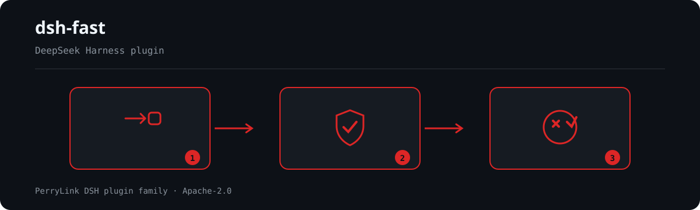

<div align="center">

# ⚡ dsh-fast
- **1024 商店渠道**：先 `npm i -g dsh1024`，再 `dsh1024 plugin --profile web add dsh-fast`（计入 [deepseek1024.com](https://deepseek1024.com) 安装排行）。

**DeepSeek Harness 的只读性能诊断插件。**

*观察会话事件流——绝不触碰模型热路径——并报告延迟与上下文预算究竟花在哪里。*

> **官方仓库。** 本仓库是 dsh-fast 的唯一官方仓库，由 PerryLink 维护。其他账号下的同名仓库与本项目无关。

[](LICENSE)
[](https://gitee.com/perrylink/dsh-fast)
[](https://github.com/topics/dsh-plugin)
[](https://github.com/PerryLink/dsh-plugin-doctor#verified-徽章)
[](https://dsh.market/)
[](#)
[](https://github.com/PerryLink/dsh-fast/actions)
[](https://github.com/PerryLink/dsh-fast/releases)
[](https://www.npmjs.com/package/dsh-fast)
[](https://www.npmjs.com/package/dsh-fast)
[](https://dshfind.com/zh/plugins/PerryLink/dsh-fast?ref=badge)

[English](README.md) · [简体中文](README-zh.md) · [Español](README-es.md) · [Português](README-pt.md) · [हिन्दी](README-hi.md)

```sh
dsh plugin --profile <name> add dsh-fast
```


</div>

---


**📖 生态实测知识库**（实测数据，不是营销）：[插件开发指南 · 选型实测数据 · 维护取舍判据](https://perrylink.github.io/dsh-plugin-guide/)。

<!-- star-cta -->
## Install & uninstall

```sh
dsh plugin --profile demo add dsh-fast       # 安装
dsh plugin --profile demo remove dsh-fast    # 卸载
```

验证行已挂载：`dsh --profile demo --dump-config | grep dsh-fast`。

## ⭐ 如果它帮到了你

这个插件是 [DSH 插件家族](https://github.com/PerryLink)的一员（95 个，全部 Apache-2.0）。如果你在用，**给个 star** —— 它不会解锁任何功能，但会让下一个人在搜索里更容易找到它。

*English:* part of a 95 plugin family for DeepSeek Harness. If it is useful, **a star helps the next person find it** — nothing is gated behind it.

## What is dsh-fast?

DeepSeek Harness 的只读性能诊断插件。

观察会话事件流——绝不触碰模型热路径——并报告延迟与上下文预算究竟花在哪里。



*工作流概览：请求 → 策略/复核 → 判定。下面的示例使用实际命令面。*


*同一次运行，动图版。*

## Compatibility

- DeepSeek Harness `dsh-v0.2.1-alpha.1`（2026-09-18 已适配）：会话表面改经可选的 `sessionQuery` 服务读取——已弃用的同步 `Session.eventAt(seq)` 访问器退役，改由等价的同步回退读兜底；所有注册收进同一个 lifecycle effect 并按逆序释放。属内部实现变更：同一日志下上报指标逐字相同。已于 2026-10-04 核验本地门控链（三把 typecheck 尺子 + 71 项测试）；compat workflow 用已发布钉号重跑 profile 安装冒烟。
- Node `^22.19.0 || >=24.0.0`，纯 ESM（`"type": "module"`）。
- peer 依赖：`@deepseek-ai/cordis ^4.0.2`、`@deepseek-ai/schemastery ^3.18.4`，以及 `@deepseek-ai/dsh-session`、`@deepseek-ai/dsh-tools`、`@deepseek-ai/dsh-commands`、`@deepseek-ai/dsh-compaction`、`@deepseek-ai/dsh-session-query`、`@deepseek-ai/dsh-storage-domain`（`>=0.1.2-rc.1 <0.2.0 || >=0.1.5-alpha.1 <0.2.0 || >=0.1.6-0 <0.2.0 || >=0.1.7-0 <0.2.0 || >=0.2.0-0 <0.3.0 || >=0.2.1-0 <0.3.0`；devDependencies 钉 `0.2.0-rc.2`）；`0.1.2-rc.1` 旧线仍通过结构式回退读取 pre-0.1.5 的 `header.system` 在运行时受支持。

## What you get

- **会话加载耗时** —— 发布到首次请求的延迟，按 `open`（全新）/`restore`（带 seed/恢复）分类，并给出恢复时的 seed 事件数。
- **spill 命中统计** —— 有多少工具结果被溢出到会话级工件（从持久化的 spill 提示标记检测）。
- **compaction 次数与触发原因** —— 总次数，按 `manual`（斜杠命令）/`automatic`（压力）区分，以及总 shadow token 数。
- **上下文注入体量** —— 系统提示词（AGENTS.md + 技能 + 人设）、工具 schema、会话表面的 token 数及其占比；其中“会话表面”只含对话历史（`0.1.5-alpha.1` 的 meter surface 含系统节点，dsh-fast 已扣除）。
- **LLM 缓存命中率** —— 由 provider usage 聚合的 input / cache-read / cache-write / output token 与命中率。
- **优化建议** —— 阈值驱动的建议（精简技能、收紧工具 schema、更早压缩、启用提示词缓存、启用 spill-policy 等）。
- **异步采样** —— 每个事件 O(1) 折叠，定时器采样，绝不在追加路径上执行。

## Quick start

```sh
dsh plugin --profile web add github:PerryLink/dsh-fast
```

### git 通道

```sh
# 在临时 profile 上（钉住 commit；运行自包含的 `prepare` 构建）
dsh plugin --profile demo add "github:YOUR_ORG/dsh-fast#<sha>"
# 首次 add 后，profile 的 pnpm-workspace.yaml 会新增针对 dsh-fast 的 allowBuilds 项。
```

### npm 通道

```sh
dsh plugin --profile demo add dsh-fast
```

两条通道都会把 bundle 行（见 `cordis.patch.yml`）装进 profile 的 `dsh.profile.bundles` 栈，重启后生效。

## `/fast` namespace collision

`/fast` 是宿主命令。若另一个插件也注册了名为 `fast` 的 **client** `commandUi`
贡献，宿主的斜杠命令菜单可能整组丢弃 `/` 来源。该冲突位于宿主的 client 命令
命名空间，本插件无法在运行时改名规避。处理方式：禁用/重命名另一个插件的
`fast` client 命令，或移除其中一个插件。没有重复 client 贡献时，`/fast` 与
`fast_report` 正常工作。

### 示例

以下为插件真实入口；安装后调用一个即可。

#### 详细示例

**命令**

~~~sh
/fast
~~~

**输出**

~~~text
dsh-fast 0.1.0 — performance report
session: abc

## Session load
kind: open
seed events: 0
time to first request: 150 ms

## Spill
detected spilled results: 0 (heuristic)

## Compaction
count: 0 (manual: 0, automatic: 0)
shadowed tokens: 0

## Context volume
total: 1000 tokens
system (AGENTS.md/skills/persona): 400 (40%)
tool schema: 200 (20%)
surface: 400 (40%)

## System prompt breakdown
persona: 100 tokens / 400 chars (25%)
skills: 0 tokens / 0 chars (0%)
AGENTS.md: 0 tokens / 0 chars (0%)
other (harness identity + tool guidance): 300 tokens / 1200 chars (75%)

## LLM cache
input: 800, cache read: 200, cache write: 50, output: 100
hit rate: 20%

## Suggestions
- none
~~~

*来源 `plugins/dsh-fast/src/analyze.ts:88-131; baseline fixture at test/analyze.spec.ts:12-35, 82-100`*

#### 失败分支

**输入**

~~~text
/fast --history nope
~~~

**输出**

~~~text
Usage: /fast [--history [n]]
~~~

*来源 `plugins/dsh-fast/src/index.ts:241-245`*

#### 简短示例

- `fast_report`

## Configuration

所有可调参数都是 Schemastery `Config` 字段；非法值会在 profile 加载时响亮失败。

| Key | Default | Description |
| --- | --- | --- |
| `enabled` | `true` | 主开关；`false` 则什么都不挂载。 |
| `privacy.includeCwd` | `false` | 是否在报告中包含脱敏后的会话工作目录。 |
| `sampling.snapshotIntervalMs` | `60000` | 活跃会话的采样间隔（毫秒）。 |
| `sampling.maxHistorySamples` | `20` | 每个会话在持久化历史中保留的样本数。 |
| `thresholds.systemPromptTokens` | `20000` | 系统提示词超过该 token 数时告警。 |
| `thresholds.toolSchemaTokens` | `8000` | 工具 schema 超过该 token 数时告警。 |
| `thresholds.surfaceTokens` | `60000` | 会话表面超过该 token 数时告警。 |
| `thresholds.cacheHitRateFloor` | `0.1` | 缓存命中率低于该值（0..1）时告警。 |
| `thresholds.compactionCountWarn` | `10` | 触发这么多 compaction 后告警。 |
| `thresholds.compactionShadowTokens` | `40000` | 每次 summary 平均 shadow token 超过该值时告警。 |
| `spill.detectSpilledResults` | `true` | 从持久化提示标记检测被溢出的工具结果。 |

## Tools & surfaces

- **`/fast`** —— 人类斜杠命令，打印当前会话的健康报告：加载耗时、spill、compaction、上下文体量排名、缓存命中率与建议。
- **`fast_report`** —— 模型工具，以结构化 JSON 返回同一份报告（供模型推理），并带人类可读的文本渲染。

## Permissions & data

`dsh-fast` 只消费公开接缝：`session/*` 与 `agent/*` 事件、可选的 `ctx.tokenMeter`、`ctx.storageDomain`、`ctx.commands` 与 `ctx.tools`。它对会话日志严格只读——绝不改动模型请求、工具结果或会话表面。度量持久化到 `dsh_fast` 存储域（每会话一段有界历史），不写会话日志。报告身份与可选的工作目录在任何展示或持久化写入前都会脱敏。

## Security boundaries

- **只读、零模型路径开销** —— 每个事件 O(1) 折叠，定时器采样。
- **无网络、无凭据处理** —— 插件不发任何出站请求，也不存储敏感信息。
- **配置响亮失败** —— 每个可调参数在挂载时校验；非法边界抛错。
- **展示/持久化数据脱敏** —— 剥离控制字符、限制字符串长度；`cwd` 默认关闭，开启时按路径截断。
- **注册可逆** —— 一切贡献都经 `ctx.effect()` / `ctx.on()` / `register()`，卸载与热重载干净。

## Known limitations

- **用存储域而非会话事件** —— rc.2 的 `Session.append` 没有 `ignorable` 标记能力，也没有外部事件注册面，写自定义 `fast/*` 会话事件会让持久化协调器在恢复时拒绝日志。因此度量改为持久化到存储域；原始事件仍是可重建的事实来源。
- **spill 检测是启发式** —— 读取持久化的 spill 提示（`Full … stored at:`）；没有专门的会话事件。
- **系统提示词是单个桶** —— AGENTS.md、技能目录与人设都属于组装后的系统提示词；自 `0.1.5-alpha.1` 起它是 surface 节点 0（`system/message`），本身不携带分段 token 统计，因此合并上报。
- **加载耗时从发布时刻起算** —— 恢复时的磁盘读取发生在 `session/created` 之前（由 `sessionPersistence` 负责），本插件允许的事件观察不到；上报的时长是发布到首次请求的延迟。
- **降级路径只播报一次** —— 无 `tokenMeter` 的宿主回退到启发式 token 计价，无 `systemPrompt` 的宿主把整段提示词并入一个桶，`inspector` 出口失败则被忽略；这三者现在各在每进程播报一次，而不是静默改变数字的含义。

## Development

```sh
pnpm install
pnpm run typecheck && pnpm run typecheck:ci && pnpm run typecheck:checkout
pnpm test
pnpm run build
pnpm run verify:self-contained && pnpm run verify:artifacts
node scripts/check-readme-sync.mjs
pnpm pack
```

## Topics

`dsh`, `dsh-plugin`, `deepseek-harness`, `deepseek`, `cordis`, `performance`, `diagnostics`, `profiling`, `context-engineering`, `llm-cache`

## Contributors

感谢所有为 `dsh-fast` 做出贡献的人：

- **[PerryLink](https://github.com/PerryLink)** —— 作者与维护者：设计并实现了只读诊断（会话加载耗时、spill 命中统计、compaction 指标、上下文注入体量、LLM 缓存命中率）、`/fast` 命令与 `fast_report` 工具、`dsh_fast` 存储域以及五语文档。

## PerryLink DSH Plugin Family

本项目是 [PerryLink](https://github.com/PerryLink) 维护的 DeepSeek Harness 插件家族成员。完整名单默认折叠，避免每个 README 的首屏被长表淹没；点击展开可查看每一行及其状态。

<details>
<summary>展开全部插件</summary>

| 插件 | 状态 |
|---|---|
| **[dsh-aqua-input-check](https://github.com/PerryLink/dsh-aqua-input-check)** |  |
| **[dsh-archive-check](https://github.com/PerryLink/dsh-archive-check)** |  |
| **[dsh-auto-review](https://github.com/PerryLink/dsh-auto-review)** |  |
| **[dsh-autotier](https://github.com/PerryLink/dsh-autotier)** |  |
| **[dsh-bid-ca-precheck](https://github.com/PerryLink/dsh-bid-ca-precheck)** |  |
| **[dsh-bid-qual-check](https://github.com/PerryLink/dsh-bid-qual-check)** |  |
| **[dsh-cert-mcp](https://github.com/PerryLink/dsh-cert-mcp)** |  |
| **[dsh-checkpoint-rewind](https://github.com/PerryLink/dsh-checkpoint-rewind)** |  |
| **[dsh-click](https://github.com/PerryLink/dsh-click)** |  |
| **[dsh-composer-history](https://github.com/PerryLink/dsh-composer-history)** |  |
| **[dsh-contract-stance](https://github.com/PerryLink/dsh-contract-stance)** |  |
| **[dsh-customs-doc-check](https://github.com/PerryLink/dsh-customs-doc-check)** |  |
| **[dsh-data-quality](https://github.com/PerryLink/dsh-data-quality)** |  |
| **[dsh-demurrage-ledger](https://github.com/PerryLink/dsh-demurrage-ledger)** |  |
| **[dsh-doublecheck](https://github.com/PerryLink/dsh-doublecheck)** |  |
| **[dsh-drill-script-check](https://github.com/PerryLink/dsh-drill-script-check)** |  |
| **[dsh-eia-guide-check](https://github.com/PerryLink/dsh-eia-guide-check)** |  |
| **[dsh-emergency-plan](https://github.com/PerryLink/dsh-emergency-plan)** |  |
| **[dsh-essay-rubric-check](https://github.com/PerryLink/dsh-essay-rubric-check)** |  |
| **[dsh-evidence-check](https://github.com/PerryLink/dsh-evidence-check)** |  |
| **[dsh-export-ctl-check](https://github.com/PerryLink/dsh-export-ctl-check)** |  |
| **[dsh-fast](https://github.com/PerryLink/dsh-fast)** |  |
| **[dsh-fmea-table-check](https://github.com/PerryLink/dsh-fmea-table-check)** |  |
| **[dsh-forecast-penalty](https://github.com/PerryLink/dsh-forecast-penalty)** |  |
| **[dsh-fund-research](https://github.com/PerryLink/dsh-fund-research)** |  |
| **[dsh-github](https://github.com/PerryLink/dsh-github)** |  |
| **[dsh-gongwen-flow-check](https://github.com/PerryLink/dsh-gongwen-flow-check)** |  |
| **[dsh-gongwen-word-check](https://github.com/PerryLink/dsh-gongwen-word-check)** |  |
| **[dsh-guard-plan-qc](https://github.com/PerryLink/dsh-guard-plan-qc)** |  |
| **[dsh-hazchem-check](https://github.com/PerryLink/dsh-hazchem-check)** |  |
| **[dsh-hazplan-check](https://github.com/PerryLink/dsh-hazplan-check)** |  |
| **[dsh-hidden-risk-map](https://github.com/PerryLink/dsh-hidden-risk-map)** |  |
| **[dsh-hs-classify](https://github.com/PerryLink/dsh-hs-classify)** |  |
| **[dsh-icd-rule-check](https://github.com/PerryLink/dsh-icd-rule-check)** |  |
| **[dsh-industry-research](https://github.com/PerryLink/dsh-industry-research)** |  |
| **[dsh-lawcite-adapter](https://github.com/PerryLink/dsh-lawcite-adapter)** |  |
| **[dsh-laya](https://github.com/PerryLink/dsh-laya)** |  |
| **[dsh-lc-doc-check](https://github.com/PerryLink/dsh-lc-doc-check)** |  |
| **[dsh-learning-gap-check](https://github.com/PerryLink/dsh-learning-gap-check)** |  |
| **[dsh-library](https://github.com/PerryLink/dsh-library)** |  |
| **[dsh-local-ai](https://github.com/PerryLink/dsh-local-ai)** |  |
| **[dsh-lsp-actions](https://github.com/PerryLink/dsh-lsp-actions)** |  |
| **[dsh-mask](https://github.com/PerryLink/dsh-mask)** |  |
| **[dsh-mcp-panel](https://github.com/PerryLink/dsh-mcp-panel)** |  |
| **[dsh-medrec-qc](https://github.com/PerryLink/dsh-medrec-qc)** |  |
| **[dsh-memento](https://github.com/PerryLink/dsh-memento)** |  |
| **[dsh-nsfc-form-check](https://github.com/PerryLink/dsh-nsfc-form-check)** |  |
| **[dsh-nurse-record-check](https://github.com/PerryLink/dsh-nurse-record-check)** |  |
| **[dsh-observe](https://github.com/PerryLink/dsh-observe)** |  |
| **[dsh-origin-rvc-check](https://github.com/PerryLink/dsh-origin-rvc-check)** |  |
| **[dsh-ota-review-check](https://github.com/PerryLink/dsh-ota-review-check)** |  |
| **[dsh-output-styles](https://github.com/PerryLink/dsh-output-styles)** |  |
| **[dsh-paper-doc-adapter](https://github.com/PerryLink/dsh-paper-doc-adapter)** |  |
| **[dsh-permission-rules](https://github.com/PerryLink/dsh-permission-rules)** |  |
| **[dsh-permit-report-check](https://github.com/PerryLink/dsh-permit-report-check)** |  |
| **[dsh-pipeline-check](https://github.com/PerryLink/dsh-pipeline-check)** |  |
| **[dsh-pleading-draft](https://github.com/PerryLink/dsh-pleading-draft)** |  |
| **[dsh-plugin-doctor](https://github.com/PerryLink/dsh-plugin-doctor)** |  |
| **[dsh-plugin-guide](https://github.com/PerryLink/dsh-plugin-guide)** |  |
| **[dsh-plugin-kit](https://github.com/PerryLink/dsh-plugin-kit)** |  |
| **[dsh-plugin-upgrade](https://github.com/PerryLink/dsh-plugin-upgrade)** |  |
| **[dsh-policy-brief-draft](https://github.com/PerryLink/dsh-policy-brief-draft)** |  |
| **[dsh-power-loss-split](https://github.com/PerryLink/dsh-power-loss-split)** |  |
| **[dsh-power-ticket-check](https://github.com/PerryLink/dsh-power-ticket-check)** |  |
| **[dsh-ppap-check](https://github.com/PerryLink/dsh-ppap-check)** |  |
| **[dsh-protest-deadline](https://github.com/PerryLink/dsh-protest-deadline)** |  |
| **[dsh-railway-window](https://github.com/PerryLink/dsh-railway-window)** |  |
| **[dsh-repair-order-qc](https://github.com/PerryLink/dsh-repair-order-qc)** |  |
| **[dsh-research-report](https://github.com/PerryLink/dsh-research-report)** |  |
| **[dsh-review-reply-check](https://github.com/PerryLink/dsh-review-reply-check)** |  |
| **[dsh-rulefile-check](https://github.com/PerryLink/dsh-rulefile-check)** |  |
| **[dsh-safety-brief-check](https://github.com/PerryLink/dsh-safety-brief-check)** |  |
| **[dsh-score](https://github.com/PerryLink/dsh-score)** |  |
| **[dsh-session-sync](https://github.com/PerryLink/dsh-session-sync)** |  |
| **[dsh-site-log-check](https://github.com/PerryLink/dsh-site-log-check)** |  |
| **[dsh-skill-pack-security](https://github.com/PerryLink/dsh-skill-pack-security)** |  |
| **[dsh-soe-decision-check](https://github.com/PerryLink/dsh-soe-decision-check)** |  |
| **[dsh-soilwater-check](https://github.com/PerryLink/dsh-soilwater-check)** |  |
| **[dsh-sop-sync-check](https://github.com/PerryLink/dsh-sop-sync-check)** |  |
| **[dsh-spc-gbt-adapter](https://github.com/PerryLink/dsh-spc-gbt-adapter)** |  |
| **[dsh-talk](https://github.com/PerryLink/dsh-talk)** |  |
| **[dsh-tender-extract](https://github.com/PerryLink/dsh-tender-extract)** |  |
| **[dsh-tender-matrix](https://github.com/PerryLink/dsh-tender-matrix)** |  |
| **[dsh-test-drive](https://github.com/PerryLink/dsh-test-drive)** |  |
| **[dsh-ticktick](https://github.com/PerryLink/dsh-ticktick)** |  |
| **[dsh-translate](https://github.com/PerryLink/dsh-translate)** |  |
| **[dsh-warranty-calc](https://github.com/PerryLink/dsh-warranty-calc)** |  |
| **[dsh-budget](https://github.com/PerryLink/dsh-budget)** | 🧊 已冻结 — 见仓库 README |
| **[dsh-claude-move](https://github.com/PerryLink/dsh-claude-move)** | 🧊 已冻结 — 见仓库 README |
| **[dsh-defend](https://github.com/PerryLink/dsh-defend)** | 🧊 已冻结 — 见仓库 README |
| **[dsh-draw](https://github.com/PerryLink/dsh-draw)** | 🧊 已冻结 — 见仓库 README |
| **[dsh-reach](https://github.com/PerryLink/dsh-reach)** | 🧊 已冻结 — 见仓库 README |
| **[dsh-background-agents](https://github.com/PerryLink/dsh-background-agents)** | 🚫 已退役 — 见仓库 README |
| **[dsh-session-pin](https://github.com/PerryLink/dsh-session-pin)** | 🚫 已退役 — 见仓库 README |
| **[dsh-team-rooms](https://github.com/PerryLink/dsh-team-rooms)** | 🚫 已退役 — 见仓库 README |

</details>

## License

Apache-2.0 —— 见 [LICENSE](LICENSE)。

### 从 DSH Desktop 市场安装

所有 PerryLink 插件均可在 DSH Desktop 内置市场中浏览：**市场 → 来源 → 添加来源 → 粘贴** `https://perrylink-dsh-catalog.perrylink.workers.dev/catalog-source.json` **→ 选中**。安装仍需通过市场的 npm 身份校验与你的确认。
