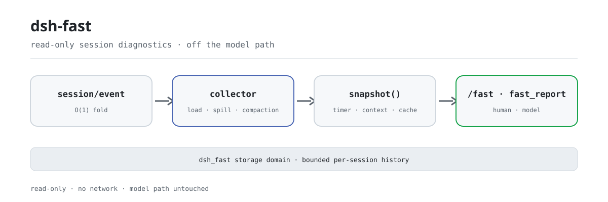

<div align="center">

<picture>
  <source media="(prefers-color-scheme: dark)" srcset="docs/assets/dsh-fast-flow-dark.svg">
  
</picture>

# dsh-fast

**See where a session actually slowed down—latency, context budget, and cache hit rate on one screen.**

Read-only performance diagnostics for DeepSeek Harness: it watches the session event stream, never the model hot path, and breaks down session load, spill, compaction, context injection, and LLM cache cost.

[Install](#three-step-setup) · [Configuration](#configuration) · [FAQ](#faq) · [简体中文](README.md) · [English](README.en.md) · [Español](README.es.md) · [Português](README.pt.md) · [हिन्दी](README.hi.md)

[](LICENSE)
[](#compatibility)
[](https://www.npmjs.com/package/dsh-fast)
[](https://github.com/PerryLink/dsh-fast/actions/workflows/ci.yml)
[](#compatibility)

[](https://github.com/PerryLink/dsh-fast/stargazers)
[](https://www.npmjs.com/package/dsh-fast)
[](https://dshfind.com/plugins/PerryLink/dsh-fast?ref=badge)
[](https://securityscorecards.dev/viewer/?uri=github.com/PerryLink/dsh-fast)
[](https://dsh.market/)
[](https://gitee.com/perrylink/dsh-fast)

```sh
dsh plugin --profile <name> add dsh-fast
```

</div>

<sub>Community plugin, not affiliated with DeepSeek. Only repository: <https://github.com/PerryLink/dsh-fast> (Gitee is a mirror).</sub>

## What it is

`dsh-fast` is a health check for a DeepSeek Harness session: one `/fast` shows the session-load time, how many tool results were spilled, how many compactions fired, how the context budget is split across system prompt / tool schema / conversation history, and the LLM cache hit rate. It is strictly read-only: it listens on `session/created`, `session/event`, and `session/disposed`, folds every event in O(1), samples snapshots on a timer, and never enters any model-request or tool-result waterfall. Metrics are written to the `dsh_fast` storage domain (one bounded history per session), not to the session log; the report identity and the optional working directory are sanitized before display.

## Three-step setup

1. **Install** (two channels):

   ```sh
   # git channel (latest main; pin a version with #v0.2.28)
   dsh plugin --profile web add github:PerryLink/dsh-fast
   dsh plugin --profile web add github:PerryLink/dsh-fast#v0.2.28
   # npm channel (published version)
   dsh plugin --profile web add dsh-fast
   ```

   Both channels install the bundle row (see [`cordis.patch.yml`](cordis.patch.yml)) into the profile's `dsh.profile.bundles` stack; it takes effect on restart.

2. **Minimal configuration** (defaults work; override on the `dsh-fast` row of the profile patch only when you need to):

   ```yaml
   - insert:
       - id: dsh-fast
         name: dsh-fast
         config:
           enabled: true
           thresholds:
             surfaceTokens: 60000
   ```

   Every key, its default, and its meaning are documented inline in [`cordis.patch.yml`](cordis.patch.yml) and in the configuration table below.

3. **Verify it is live**:

   ```sh
   dsh --profile demo --dump-config | grep -A2 'id: dsh-fast'
   ```

   After a restart, run `/fast` in any session; a first line containing `performance report` means the row is mounted.

**Uninstall**: `dsh plugin --profile demo remove dsh-fast` (or delete the row from the profile patch).

<details>
<summary>Install from the DSH Desktop market</summary>

Every PerryLink plugin can be browsed in the built-in DSH Desktop market: **Market → Sources → add source → paste** `https://perrylink-dsh-catalog.perrylink.workers.dev/catalog-source.json` **→ select it**. Installation still goes through the market's npm identity check and your confirmation.

</details>

## Core capabilities

`dsh-fast` turns "where did this session go slow" into readable numbers:

- **Session load timing** — publication-to-first-request latency, classified `open` (fresh) vs `restore` (seeded/resumed), plus the restored seed-event count.
- **Spill-hit statistics** — how many tool results were spilled to a session-scoped artifact (detected from the durable spill notice).
- **Compaction count and trigger** — total compactions, split `manual` (slash command) vs `automatic` (pressure), and total shadowed tokens.
- **Context-injection volume** — system-prompt (AGENTS.md + skills + persona), tool-schema, and surface tokens with their shares of the total; the surface bucket is conversation history only (the meter's surface includes the system node on `0.1.5-alpha.1`, which dsh-fast subtracts).
- **LLM cache hit rate** — input / cache-read / cache-write / output tokens aggregated from provider usage, plus the derived hit rate.
- **Optimization suggestions** — threshold-driven notes (trim skills, tighten tool schemas, compact earlier, enable prompt caching, enable spill-policy, …).
- **History view** — `/fast --history [n]` prints the last n samples from the `dsh_fast` domain (10 by default), so you see the trend rather than one point.
- **Async sampling** — metrics are folded O(1) per event and snapshotted on a timer, never on the append path.

### Commands & tools

| Surface | Output | Description |
|---|---|---|
| `/fast` | Text report | Prints the current session's health report: load timing, spill, compaction, context-volume ranking, cache hit rate, and suggestions |
| `/fast --history [n]` | Text history | Prints the durable sample history in the `dsh_fast` domain (written per session by the sampling timer) |
| `fast_report` | Structured JSON | Returns the same report (so the model can reason over it), with a human-readable text render |

### Examples

These are the plugin's real entry points; install once, then call one.

**Detailed example** — command `/fast`:

```sh
/fast
```

Output:

~~~text
dsh-fast 0.1.0 — performance report
session: abc

## Session load
kind: open
seed events: 0
time to first request: 150 ms

## Spill
detected spilled results: 0 (heuristic)

## Compaction
count: 0 (manual: 0, automatic: 0)
shadowed tokens: 0

## Context volume
total: 1000 tokens
system (AGENTS.md/skills/persona): 400 (40%)
tool schema: 200 (20%)
surface: 400 (40%)

## System prompt breakdown
persona: 100 tokens / 400 chars (25%)
skills: 0 tokens / 0 chars (0%)
AGENTS.md: 0 tokens / 0 chars (0%)
other (harness identity + tool guidance): 300 tokens / 1200 chars (75%)

## LLM cache
input: 800, cache read: 200, cache write: 50, output: 100
hit rate: 20%

## Suggestions
- none
~~~

*Observed from `plugins/dsh-fast/src/analyze.ts:88-131; baseline fixture at test/analyze.spec.ts:12-35, 82-100`*

**Failure branch** — input `/fast --history nope`, output:

~~~text
Usage: /fast [--history [n]]
~~~

*Observed from `plugins/dsh-fast/src/index.ts:241-245`*

**Brief examples**: `fast_report`

## Configuration

All tunables are Schemastery `Config` fields; invalid values fail the profile load loudly (positive-integer bounds and `0..1` ratios are checked). [`cordis.patch.yml`](cordis.patch.yml) documents every key inline.

Most-used keys:

| Key | Default | Meaning |
| --- | --- | --- |
| `enabled` | `true` | Master switch; `false` mounts nothing. |
| `privacy.includeCwd` | `false` | Include the sanitized session working directory in reports. |
| `sampling.snapshotIntervalMs` | `60000` | How often active sessions are sampled (ms). |
| `sampling.maxHistorySamples` | `20` | Samples retained per session in the durable history. |
| `thresholds.systemPromptTokens` | `20000` | Warn when the system prompt exceeds this many tokens. |
| `thresholds.surfaceTokens` | `60000` | Warn when the conversation surface exceeds this many tokens. |
| `spill.detectSpilledResults` | `true` | Detect spilled tool results from the durable notice marker. |

<details>
<summary>Full configuration table (11 keys)</summary>

| Key | Default | Meaning |
| --- | --- | --- |
| `enabled` | `true` | Master switch; `false` mounts nothing. |
| `privacy.includeCwd` | `false` | Include the sanitized session working directory in reports. |
| `sampling.snapshotIntervalMs` | `60000` | How often active sessions are sampled (ms). |
| `sampling.maxHistorySamples` | `20` | Samples retained per session in the durable history. |
| `thresholds.systemPromptTokens` | `20000` | Warn when the system prompt exceeds this many tokens. |
| `thresholds.toolSchemaTokens` | `8000` | Warn when the tool schema exceeds this many tokens. |
| `thresholds.surfaceTokens` | `60000` | Warn when the conversation surface exceeds this many tokens. |
| `thresholds.cacheHitRateFloor` | `0.1` | Warn when the cache hit rate falls below this (0..1). |
| `thresholds.compactionCountWarn` | `10` | Warn once this many compactions have triggered. |
| `thresholds.compactionShadowTokens` | `40000` | Warn when the average shadowed token count per summary exceeds this. |
| `spill.detectSpilledResults` | `true` | Detect spilled tool results from the durable notice marker. |

</details>

Profile-patch override example:

```yaml
- insert:
    - id: dsh-fast
      name: dsh-fast
      config:
        thresholds:
          cacheHitRateFloor: 0.2
        sampling:
          snapshotIntervalMs: 30000
```

## FAQ

<details>
<summary>Does it slow the model down? What is the overhead?</summary>

No. Folding hangs off `session/event` and is O(1) per event; snapshots are produced on the `snapshotIntervalMs` timer (60 seconds by default), never on the append path or the model-request path; `/fast` and `fast_report` only assemble a report when invoked. It registers no waterfall listeners and never mutates the model request, tool results, or the session surface.

</details>

<details>
<summary>Where are the metrics stored? Do they enter the session log or leak sensitive data?</summary>

Snapshots are written to the `dsh_fast` storage domain (one bounded history per session, `maxHistorySamples` defaults to 20) and **never to the session log**; the raw session events remain the reconstructable source of truth. The report's `sessionId` is sanitized; `cwd` is absent by default and, with `privacy.includeCwd: true`, only the truncated path is emitted; control characters are stripped before any display or durable write. The plugin makes no network requests and handles no credentials.

</details>

<details>
<summary>What happens when optional host services are missing? Do the numbers change silently?</summary>

They do not change silently. Without `tokenMeter` it falls back to heuristic token pricing; without `systemPrompt` the whole system prompt is attributed to one bucket; a failing `inspector` outlet is ignored—each of these now says so once per process. When `sessionQuery` is unavailable it falls back to an equivalent synchronous read, and a failed read is announced and takes the fallback path.

</details>

<details>
<summary>Why a storage domain instead of `fast/*` session events?</summary>

The rc.2 `Session.append` offers no `ignorable` marker and no external event-registration surface; a custom `fast/*` session event would make the persistence coordinator refuse the log on restore. Metrics therefore live in the storage domain, and the raw session events remain the reconstructable source of truth (see Known limitations).

</details>

<details>
<summary>Does it collide with other plugins over command names or events?</summary>

There is exactly one known collision: if another plugin registers a **client** `commandUi` contribution also named `fast`, the host's slash-command menu can drop the whole `/` source. That collision is in the host's client namespace and this plugin cannot rename at runtime; disable/rename the other plugin's `fast` client command, or remove one of the plugins. Otherwise it registers one command, one tool, three read-only `session/*` listeners, and one storage domain—no services, no client slots, no HTTP routes.

</details>

## Security boundaries

- **Read-only, zero model-path overhead** — folding is O(1) per event; sampling runs on a timer.
- **No network, no credential handling** — the plugin makes no outbound requests and stores nothing sensitive.
- **Fail-loud configuration** — every tunable is validated at mount; invalid bounds throw.
- **Sanitized display/durable data** — control characters are stripped and strings are budgeted; `cwd` is off by default and path-truncated when enabled.
- **Reversible registrations** — every contribution goes through `ctx.effect()` / `ctx.on()` / `register()`, so uninstall and hot reload are clean.

## Permissions & data

`dsh-fast` consumes only public seams: `session/*` and `agent/*` events, the optional `ctx.tokenMeter`, `ctx.storageDomain`, `ctx.commands`, and `ctx.tools`. It is strictly read-only over the session log—it never mutates the model request, tool results, or the session surface. Metrics are persisted to the `dsh_fast` storage domain (one bounded history per session), not to the session log. Report identity and the optional working directory are sanitized before any display or durable write.

## Known limitations

- **Storage domain, not session events** — rc.2 `Session.append` offers no `ignorable` marker and no external event-registration surface, so a custom `fast/*` session event would make the persistence coordinator refuse the log on restore. Metrics are therefore persisted to the storage domain; the raw events remain the reconstructable source of truth.
- **Spill detection is heuristic** — it reads the durable spill notice (`Full … stored at:`); no dedicated session event exists.
- **System prompt is one bucket** — AGENTS.md, skill directory, and persona are all part of the assembled system prompt; since `0.1.5-alpha.1` it is surface node 0 (a `system/message`) and carries no per-section token accounting, so they are reported together.
- **Load timing starts at publication** — the disk-read portion of a restore happens before `session/created` (owned by `sessionPersistence`) and is not observable from this plugin's allowed events; the reported duration is publication-to-first-request.
- **Degradations are announced once** — a host without `tokenMeter` falls back to heuristic token pricing, a host without `systemPrompt` attributes the whole prompt to one bucket, and a failing `inspector` outlet is ignored; each of these now says so once per process instead of changing what the numbers mean in silence.

## Interoperability with other DSH plugins

This README targets DeepSeek Harness `0.2.1-alpha.1` (see Compatibility for the supported range). This plugin registers exactly one command (`/fast`), one tool (`fast_report`), three read-only listeners (`session/created`, `session/event`, `session/disposed`), and one `dsh_fast` storage domain: it provides no services, registers no client slots, registers no `webServer` routes, and listens on no waterfall—so it cannot rewrite the model request, tool results, or the session surface, and it does not participate in any other plugin's hot path.

The only known collision is in the host's client command namespace: `/fast` is a host command name, and if another plugin also registers a **client** `commandUi` contribution named `fast`, the host's slash-command menu can drop the whole `/` source. This plugin cannot rename at runtime to avoid it. Workaround: disable/rename the other plugin's `fast` client command, or remove one of the plugins. `/fast` and `fast_report` keep working when no duplicate client contribution exists.

## Compatibility

| Dimension | Status |
|---|---|
| Harness | DeepSeek Harness `dsh-v0.2.1-alpha.1` (adapted 2026-09-18): the session surface is read through the optional `sessionQuery` service—the deprecated synchronous `Session.eventAt(seq)` accessor is gone, with an equivalent synchronous read as the fallback—and every registration now lives in one lifecycle effect that releases them in reverse order. Internal implementation change: the reported metrics are identical for the same log. Verified 2026-10-04 against the local gate chain (three typecheck rulers + 71 tests); the compat workflow re-runs the profile install smoke against the published pins. |
| Node | `^22.19.0 \|\| >=24.0.0`, ESM only (`"type": "module"`). |
| Platform | Anywhere DSH runs (pure host; no network, no browser half). |
| Model | Text models are enough; `fast_report` returns structured JSON and needs no extra model capability. |

Peer dependencies: `@deepseek-ai/cordis ^4.0.2`, `@deepseek-ai/schemastery ^3.18.4`, and `@deepseek-ai/dsh-session`, `@deepseek-ai/dsh-tools`, `@deepseek-ai/dsh-commands`, `@deepseek-ai/dsh-compaction`, `@deepseek-ai/dsh-session-query`, `@deepseek-ai/dsh-storage-domain` at `>=0.1.2-rc.1 <0.2.0 || >=0.1.5-alpha.1 <0.2.0 || >=0.1.6-0 <0.2.0 || >=0.1.7-0 <0.2.0 || >=0.2.0-0 <0.3.0 || >=0.2.1-0 <0.3.0` (devDependencies pin `0.2.1-rc.2`); the `0.1.2-rc.1` line stays supported at runtime through a structural fallback to the pre-0.1.5 `header.system`.

## Ecosystem & quality

- [Gitee mirror](https://gitee.com/perrylink/dsh-fast) (sync mirror; GitHub is authoritative)
- [dshfind plugin page](https://dshfind.com/plugins/PerryLink/dsh-fast) (installs and ranking)
- [OpenSSF Scorecard report](https://securityscorecards.dev/viewer/?uri=github.com/PerryLink/dsh-fast) (driven by [.github/workflows/scorecard.yml](.github/workflows/scorecard.yml))
- [dsh-plugin-doctor verification report](https://github.com/PerryLink/dsh-plugin-doctor#verified-徽章)
- [DSH Market](https://dsh.market/) (listed)
- **1024 store channel**: `npm i -g dsh1024` once, then `dsh1024 plugin --profile web add dsh-fast` (counts toward the [deepseek1024.com](https://deepseek1024.com) install ranking)
- [Ecosystem knowledge base](https://perrylink.github.io/dsh-plugin-guide/): plugin development guide · selection data · maintenance criteria

## Development

```sh
pnpm install
pnpm run typecheck && pnpm run typecheck:ci && pnpm run typecheck:checkout
pnpm test
pnpm run build
pnpm run verify:self-contained && pnpm run verify:artifacts
node scripts/check-readme-sync.mjs
pnpm pack
```

The README images are generated by [`scripts/gen-readme-assets.py`](scripts/gen-readme-assets.py) (Python 3 standard library, no Pillow needed); it writes the light/dark pair `docs/assets/dsh-fast-flow-{light,dark}.svg` and is idempotent. The older single-theme `docs/assets/dsh-fast-flow.svg`, `dsh-fast-hero.png`, and `dsh-fast-demo.*` stay in place so external links do not 404; the READMEs no longer reference them.

Topics: `dsh`, `dsh-plugin`, `deepseek-harness`, `deepseek`, `cordis`, `performance`, `diagnostics`, `profiling`, `context-engineering`, `llm-cache`

## Family & thanks

This project is part of the DeepSeek Harness plugin family maintained by [PerryLink](https://github.com/PerryLink) (all Apache-2.0). If this plugin is useful, **give it a star**—it unlocks nothing, but it makes the next person find it faster.

- [@PerryLink](https://github.com/PerryLink) — author and maintainer: designed and built the read-only diagnostics (session-load timing, spill-hit counts, compaction metrics, context-injection volume, LLM cache hit rate), the `/fast` command and `fast_report` tool, the `dsh_fast` storage domain, and the five-language documentation.

<details>
<summary>Expand all plugins</summary>

| Plugin | Status |
|---|---|
| **[dsh-aqua-input-check](https://github.com/PerryLink/dsh-aqua-input-check)** |  |
| **[dsh-archive-check](https://github.com/PerryLink/dsh-archive-check)** |  |
| **[dsh-auto-review](https://github.com/PerryLink/dsh-auto-review)** |  |
| **[dsh-autotier](https://github.com/PerryLink/dsh-autotier)** | 🧊 FROZEN — see the repo README |
| **[dsh-bid-ca-precheck](https://github.com/PerryLink/dsh-bid-ca-precheck)** |  |
| **[dsh-bid-qual-check](https://github.com/PerryLink/dsh-bid-qual-check)** |  |
| **[dsh-cert-mcp](https://github.com/PerryLink/dsh-cert-mcp)** | 🧊 FROZEN — see the repo README |
| **[dsh-checkpoint-rewind](https://github.com/PerryLink/dsh-checkpoint-rewind)** |  |
| **[dsh-click](https://github.com/PerryLink/dsh-click)** |  |
| **[dsh-composer-history](https://github.com/PerryLink/dsh-composer-history)** |  |
| **[dsh-contract-stance](https://github.com/PerryLink/dsh-contract-stance)** |  |
| **[dsh-customs-doc-check](https://github.com/PerryLink/dsh-customs-doc-check)** |  |
| **[dsh-data-quality](https://github.com/PerryLink/dsh-data-quality)** | 🧊 FROZEN — see the repo README |
| **[dsh-demurrage-ledger](https://github.com/PerryLink/dsh-demurrage-ledger)** |  |
| **[dsh-doublecheck](https://github.com/PerryLink/dsh-doublecheck)** |  |
| **[dsh-drill-script-check](https://github.com/PerryLink/dsh-drill-script-check)** |  |
| **[dsh-eia-guide-check](https://github.com/PerryLink/dsh-eia-guide-check)** |  |
| **[dsh-emergency-plan](https://github.com/PerryLink/dsh-emergency-plan)** |  |
| **[dsh-essay-rubric-check](https://github.com/PerryLink/dsh-essay-rubric-check)** |  |
| **[dsh-evidence-check](https://github.com/PerryLink/dsh-evidence-check)** |  |
| **[dsh-export-ctl-check](https://github.com/PerryLink/dsh-export-ctl-check)** |  |
| **[dsh-fast](https://github.com/PerryLink/dsh-fast)** |  |
| **[dsh-fmea-table-check](https://github.com/PerryLink/dsh-fmea-table-check)** |  |
| **[dsh-forecast-penalty](https://github.com/PerryLink/dsh-forecast-penalty)** |  |
| **[dsh-fund-research](https://github.com/PerryLink/dsh-fund-research)** |  |
| **[dsh-github](https://github.com/PerryLink/dsh-github)** |  |
| **[dsh-gongwen-flow-check](https://github.com/PerryLink/dsh-gongwen-flow-check)** |  |
| **[dsh-gongwen-word-check](https://github.com/PerryLink/dsh-gongwen-word-check)** |  |
| **[dsh-guard-plan-qc](https://github.com/PerryLink/dsh-guard-plan-qc)** |  |
| **[dsh-hazchem-check](https://github.com/PerryLink/dsh-hazchem-check)** |  |
| **[dsh-hazplan-check](https://github.com/PerryLink/dsh-hazplan-check)** |  |
| **[dsh-hidden-risk-map](https://github.com/PerryLink/dsh-hidden-risk-map)** |  |
| **[dsh-hs-classify](https://github.com/PerryLink/dsh-hs-classify)** |  |
| **[dsh-icd-rule-check](https://github.com/PerryLink/dsh-icd-rule-check)** |  |
| **[dsh-industry-research](https://github.com/PerryLink/dsh-industry-research)** |  |
| **[dsh-lawcite-adapter](https://github.com/PerryLink/dsh-lawcite-adapter)** |  |
| **[dsh-laya](https://github.com/PerryLink/dsh-laya)** |  |
| **[dsh-lc-doc-check](https://github.com/PerryLink/dsh-lc-doc-check)** |  |
| **[dsh-learning-gap-check](https://github.com/PerryLink/dsh-learning-gap-check)** |  |
| **[dsh-library](https://github.com/PerryLink/dsh-library)** |  |
| **[dsh-local-ai](https://github.com/PerryLink/dsh-local-ai)** |  |
| **[dsh-lsp-actions](https://github.com/PerryLink/dsh-lsp-actions)** |  |
| **[dsh-mask](https://github.com/PerryLink/dsh-mask)** |  |
| **[dsh-mcp-panel](https://github.com/PerryLink/dsh-mcp-panel)** |  |
| **[dsh-medrec-qc](https://github.com/PerryLink/dsh-medrec-qc)** |  |
| **[dsh-memento](https://github.com/PerryLink/dsh-memento)** | 🧊 FROZEN — see the repo README |
| **[dsh-nsfc-form-check](https://github.com/PerryLink/dsh-nsfc-form-check)** |  |
| **[dsh-nurse-record-check](https://github.com/PerryLink/dsh-nurse-record-check)** |  |
| **[dsh-observe](https://github.com/PerryLink/dsh-observe)** |  |
| **[dsh-origin-rvc-check](https://github.com/PerryLink/dsh-origin-rvc-check)** |  |
| **[dsh-ota-review-check](https://github.com/PerryLink/dsh-ota-review-check)** |  |
| **[dsh-output-styles](https://github.com/PerryLink/dsh-output-styles)** |  |
| **[dsh-paper-doc-adapter](https://github.com/PerryLink/dsh-paper-doc-adapter)** |  |
| **[dsh-permission-rules](https://github.com/PerryLink/dsh-permission-rules)** |  |
| **[dsh-permit-report-check](https://github.com/PerryLink/dsh-permit-report-check)** |  |
| **[dsh-pipeline-check](https://github.com/PerryLink/dsh-pipeline-check)** |  |
| **[dsh-pleading-draft](https://github.com/PerryLink/dsh-pleading-draft)** |  |
| **[dsh-plugin-doctor](https://github.com/PerryLink/dsh-plugin-doctor)** | 🚫 RETIRED (repo archived) |
| **[dsh-plugin-guide](https://github.com/PerryLink/dsh-plugin-guide)** |  |
| **[dsh-plugin-kit](https://github.com/PerryLink/dsh-plugin-kit)** | 🚫 RETIRED (repo archived) |
| **[dsh-plugin-upgrade](https://github.com/PerryLink/dsh-plugin-upgrade)** | 🚫 RETIRED (repo archived) |
| **[dsh-policy-brief-draft](https://github.com/PerryLink/dsh-policy-brief-draft)** |  |
| **[dsh-power-loss-split](https://github.com/PerryLink/dsh-power-loss-split)** |  |
| **[dsh-power-ticket-check](https://github.com/PerryLink/dsh-power-ticket-check)** |  |
| **[dsh-ppap-check](https://github.com/PerryLink/dsh-ppap-check)** |  |
| **[dsh-protest-deadline](https://github.com/PerryLink/dsh-protest-deadline)** |  |
| **[dsh-railway-window](https://github.com/PerryLink/dsh-railway-window)** |  |
| **[dsh-repair-order-qc](https://github.com/PerryLink/dsh-repair-order-qc)** |  |
| **[dsh-research-report](https://github.com/PerryLink/dsh-research-report)** |  |
| **[dsh-review-reply-check](https://github.com/PerryLink/dsh-review-reply-check)** |  |
| **[dsh-rulefile-check](https://github.com/PerryLink/dsh-rulefile-check)** |  |
| **[dsh-safety-brief-check](https://github.com/PerryLink/dsh-safety-brief-check)** |  |
| **[dsh-score](https://github.com/PerryLink/dsh-score)** | 🧊 FROZEN — see the repo README |
| **[dsh-session-sync](https://github.com/PerryLink/dsh-session-sync)** |  |
| **[dsh-site-log-check](https://github.com/PerryLink/dsh-site-log-check)** |  |
| **[dsh-skill-pack-security](https://github.com/PerryLink/dsh-skill-pack-security)** |  |
| **[dsh-soe-decision-check](https://github.com/PerryLink/dsh-soe-decision-check)** |  |
| **[dsh-soilwater-check](https://github.com/PerryLink/dsh-soilwater-check)** |  |
| **[dsh-sop-sync-check](https://github.com/PerryLink/dsh-sop-sync-check)** |  |
| **[dsh-spc-gbt-adapter](https://github.com/PerryLink/dsh-spc-gbt-adapter)** |  |
| **[dsh-talk](https://github.com/PerryLink/dsh-talk)** |  |
| **[dsh-tender-extract](https://github.com/PerryLink/dsh-tender-extract)** |  |
| **[dsh-tender-matrix](https://github.com/PerryLink/dsh-tender-matrix)** |  |
| **[dsh-test-drive](https://github.com/PerryLink/dsh-test-drive)** |  |
| **[dsh-ticktick](https://github.com/PerryLink/dsh-ticktick)** | 🚫 RETIRED (repo archived) |
| **[dsh-translate](https://github.com/PerryLink/dsh-translate)** |  |
| **[dsh-warranty-calc](https://github.com/PerryLink/dsh-warranty-calc)** |  |
| **[dsh-budget](https://github.com/PerryLink/dsh-budget)** | 🧊 FROZEN — see the repo README |
| **[dsh-claude-move](https://github.com/PerryLink/dsh-claude-move)** | 🧊 FROZEN — see the repo README |
| **[dsh-defend](https://github.com/PerryLink/dsh-defend)** | 🧊 FROZEN — see the repo README |
| **[dsh-draw](https://github.com/PerryLink/dsh-draw)** | 🧊 FROZEN — see the repo README |
| **[dsh-reach](https://github.com/PerryLink/dsh-reach)** | 🧊 FROZEN — see the repo README |
| **[dsh-background-agents](https://github.com/PerryLink/dsh-background-agents)** | 🚫 RETIRED (repo archived) |
| **[dsh-session-pin](https://github.com/PerryLink/dsh-session-pin)** | 🚫 RETIRED (repo archived) |
| **[dsh-team-rooms](https://github.com/PerryLink/dsh-team-rooms)** | 🚫 RETIRED (repo archived) |

</details>

## License

[LICENSE](LICENSE) (Apache License 2.0) © 2026 dsh-fast contributors

<p align="center"><sub>Apache-2.0 · Community plugin, not affiliated with DeepSeek.</sub></p>
