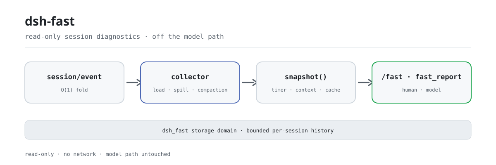

<div align="center">

<picture>
  <source media="(prefers-color-scheme: dark)" srcset="docs/assets/dsh-fast-flow-dark.svg">
  
</picture>

# dsh-fast

**Descubre en qué se frenó una sesión—latencia, presupuesto de contexto y tasa de aciertos de caché en una sola pantalla.**

Diagnóstico de rendimiento de solo lectura para DeepSeek Harness: observa el flujo de eventos de sesión, nunca la ruta caliente del modelo, y desglosa carga de sesión, spill, compactación, inyección de contexto y coste de la caché LLM.

[Instalar](#instalación-en-tres-pasos) · [Configuración](#configuración) · [FAQ](#faq) · [简体中文](README.md) · [English](README.en.md) · [Español](README.es.md) · [Português](README.pt.md) · [हिन्दी](README.hi.md)

[](LICENSE)
[](#compatibilidad)
[](https://www.npmjs.com/package/dsh-fast)
[](https://github.com/PerryLink/dsh-fast/actions/workflows/ci.yml)
[](#compatibilidad)

[](https://github.com/PerryLink/dsh-fast/stargazers)
[](https://www.npmjs.com/package/dsh-fast)
[](https://dshfind.com/plugins/PerryLink/dsh-fast?ref=badge)
[](https://securityscorecards.dev/viewer/?uri=github.com/PerryLink/dsh-fast)
[](https://dsh.market/)
[](https://gitee.com/perrylink/dsh-fast)

```sh
dsh plugin --profile <name> add dsh-fast
```

</div>

<sub>Plugin comunitario, no afiliado a DeepSeek. Único repositorio: <https://github.com/PerryLink/dsh-fast> (Gitee es un espejo).</sub>

## Qué es

`dsh-fast` es un chequeo de salud de una sesión de DeepSeek Harness: un solo `/fast` muestra el tiempo de carga de la sesión, cuántos resultados de herramienta se derramaron (spill), cuántas compactaciones se dispararon, cómo se reparte el presupuesto de contexto entre system prompt / schema de herramientas / historial de conversación, y la tasa de aciertos de la caché LLM. Es estrictamente de solo lectura: escucha `session/created`, `session/event` y `session/disposed`, pliega cada evento en O(1), muestrea instantáneas en un temporizador y nunca entra en el waterfall de la petición del modelo ni de los resultados de herramientas. Las métricas se escriben en el dominio de almacenamiento `dsh_fast` (una historia acotada por sesión), no en el log de sesión; la identidad del informe y el directorio de trabajo opcional se sanean antes de mostrarse.

## Instalación en tres pasos

1. **Instalar** (dos canales):

   ```sh
   # canal git (último main; fija una versión con #v0.2.28)
   dsh plugin --profile web add github:PerryLink/dsh-fast
   dsh plugin --profile web add github:PerryLink/dsh-fast#v0.2.28
   # canal npm (versión publicada)
   dsh plugin --profile web add dsh-fast
   ```

   Ambos canales instalan la fila del bundle (ver [`cordis.patch.yml`](cordis.patch.yml)) en la pila `dsh.profile.bundles` del profile; surte efecto al reiniciar.

2. **Configuración mínima** (los valores por defecto funcionan; sobrescribe en la fila `dsh-fast` del patch del profile solo si lo necesitas):

   ```yaml
   - insert:
       - id: dsh-fast
         name: dsh-fast
         config:
           enabled: true
           thresholds:
             surfaceTokens: 60000
   ```

   Cada clave, su valor por defecto y su significado están documentados en línea en [`cordis.patch.yml`](cordis.patch.yml) y en la tabla de configuración de abajo.

3. **Verificar que está activo**:

   ```sh
   dsh --profile demo --dump-config | grep -A2 'id: dsh-fast'
   ```

   Tras reiniciar, ejecuta `/fast` en cualquier sesión; si la primera línea contiene `performance report`, la fila está montada.

**Desinstalar**: `dsh plugin --profile demo remove dsh-fast` (o borra la fila del patch del profile).

<details>
<summary>Instalar desde el mercado de DSH Desktop</summary>

Todos los plugins de PerryLink pueden explorarse en el mercado integrado de DSH Desktop: **Market → Sources → add source → pegar** `https://perrylink-dsh-catalog.perrylink.workers.dev/catalog-source.json` **→ seleccionarlo**. La instalación sigue pasando por la verificación de identidad npm del mercado y tu confirmación.

</details>

## Capacidades clave

`dsh-fast` convierte «dónde se frenó esta sesión» en números legibles:

- **Tiempo de carga de sesión** — latencia publicación→primera petición, clasificada `open` (nueva) o `restore` (con semilla/reanudada), más el número de eventos semilla.
- **Recuento de spill** — cuántos resultados de herramienta se volcaron a un artefacto de sesión (detectado por el aviso persistente de spill).
- **Recuento y motivo de compactación** — total, separado `manual` (comando) vs `automatic` (presión), y tokens sombreados totales.
- **Volumen de contexto inyectado** — tokens de system-prompt (AGENTS.md + skills + persona), schema de herramientas y superficie, con sus porcentajes; la superficie es solo historial de conversación (en `0.1.5-alpha.1` la superficie del meter incluye el nodo de sistema, que dsh-fast descuenta).
- **Tasa de aciertos de caché LLM** — tokens input / cache-read / cache-write / output agregados y la tasa derivada.
- **Sugerencias de optimización** — basadas en umbrales (recortar skills, ajustar schemas, compactar antes, activar caché de prompts, activar spill-policy…).
- **Vista de historial** — `/fast --history [n]` imprime las últimas n muestras del dominio `dsh_fast` (10 por defecto), para ver la tendencia en vez de un solo punto.
- **Muestreo asíncrono** — plegado O(1) por evento; el muestreo corre en un temporizador, nunca en la ruta de append.

### Comandos y herramientas

| Superficie | Salida | Descripción |
|---|---|---|
| `/fast` | Informe de texto | Imprime el informe de salud de la sesión: carga, spill, compactación, ranking de volumen de contexto, tasa de caché y sugerencias |
| `/fast --history [n]` | Historial de texto | Imprime el historial durable de muestras del dominio `dsh_fast` (escrito por sesión por el temporizador de muestreo) |
| `fast_report` | JSON estructurado | Devuelve el mismo informe (para que el modelo razone), con render de texto legible |

### Ejemplos

Son los puntos de entrada reales; instala y llama a uno.

**Ejemplo detallado** — comando `/fast`:

```sh
/fast
```

Salida:

~~~text
dsh-fast 0.1.0 — performance report
session: abc

## Session load
kind: open
seed events: 0
time to first request: 150 ms

## Spill
detected spilled results: 0 (heuristic)

## Compaction
count: 0 (manual: 0, automatic: 0)
shadowed tokens: 0

## Context volume
total: 1000 tokens
system (AGENTS.md/skills/persona): 400 (40%)
tool schema: 200 (20%)
surface: 400 (40%)

## System prompt breakdown
persona: 100 tokens / 400 chars (25%)
skills: 0 tokens / 0 chars (0%)
AGENTS.md: 0 tokens / 0 chars (0%)
other (harness identity + tool guidance): 300 tokens / 1200 chars (75%)

## LLM cache
input: 800, cache read: 200, cache write: 50, output: 100
hit rate: 20%

## Suggestions
- none
~~~

*Observed from `plugins/dsh-fast/src/analyze.ts:88-131; baseline fixture at test/analyze.spec.ts:12-35, 82-100`*

**Rama de fallo** — entrada `/fast --history nope`, salida:

~~~text
Usage: /fast [--history [n]]
~~~

*Observed from `plugins/dsh-fast/src/index.ts:241-245`*

**Ejemplos breves**: `fast_report`

## Configuración

Todos los ajustes son campos Schemastery `Config`; los valores inválidos fallan la carga del profile de forma audible (se validan los enteros positivos y las proporciones `0..1`). [`cordis.patch.yml`](cordis.patch.yml) comenta cada clave en línea.

Claves más usadas:

| Clave | Predeterminado | Significado |
| --- | --- | --- |
| `enabled` | `true` | Interruptor maestro; `false` no monta nada. |
| `privacy.includeCwd` | `false` | Incluir el directorio de trabajo saneado en los informes. |
| `sampling.snapshotIntervalMs` | `60000` | Cada cuánto se muestrean las sesiones activas (ms). |
| `sampling.maxHistorySamples` | `20` | Muestras retenidas por sesión en el historial durable. |
| `thresholds.systemPromptTokens` | `20000` | Avisar si el system prompt supera estos tokens. |
| `thresholds.surfaceTokens` | `60000` | Avisar si la superficie supera estos tokens. |
| `spill.detectSpilledResults` | `true` | Detectar resultados volcados por el marcador de aviso persistente. |

<details>
<summary>Tabla completa de configuración (11 claves)</summary>

| Clave | Predeterminado | Significado |
| --- | --- | --- |
| `enabled` | `true` | Interruptor maestro; `false` no monta nada. |
| `privacy.includeCwd` | `false` | Incluir el directorio de trabajo saneado en los informes. |
| `sampling.snapshotIntervalMs` | `60000` | Cada cuánto se muestrean las sesiones activas (ms). |
| `sampling.maxHistorySamples` | `20` | Muestras retenidas por sesión en el historial durable. |
| `thresholds.systemPromptTokens` | `20000` | Avisar si el system prompt supera estos tokens. |
| `thresholds.toolSchemaTokens` | `8000` | Avisar si el schema de herramientas supera estos tokens. |
| `thresholds.surfaceTokens` | `60000` | Avisar si la superficie supera estos tokens. |
| `thresholds.cacheHitRateFloor` | `0.1` | Avisar si la tasa de caché cae por debajo (0..1). |
| `thresholds.compactionCountWarn` | `10` | Avisar tras tantas compactaciones. |
| `thresholds.compactionShadowTokens` | `40000` | Avisar si el promedio de tokens sombreados por summary supera esto. |
| `spill.detectSpilledResults` | `true` | Detectar resultados volcados por el marcador de aviso persistente. |

</details>

Ejemplo de sobrescritura en el patch del profile:

```yaml
- insert:
    - id: dsh-fast
      name: dsh-fast
      config:
        thresholds:
          cacheHitRateFloor: 0.2
        sampling:
          snapshotIntervalMs: 30000
```

## FAQ

<details>
<summary>¿Ralentiza el modelo? ¿Cuánta sobrecarga añade?</summary>

No. El plegado cuelga de `session/event` y es O(1) por evento; las instantáneas se producen con el temporizador `snapshotIntervalMs` (60 segundos por defecto), nunca en la ruta de append ni en la de la petición del modelo; `/fast` y `fast_report` solo ensamblan un informe cuando se invocan. No registra listeners waterfall y nunca muta la petición del modelo, los resultados de herramientas ni la superficie de sesión.

</details>

<details>
<summary>¿Dónde se guardan las métricas? ¿Entran en el log de sesión o filtran datos sensibles?</summary>

Las instantáneas se escriben en el dominio de almacenamiento `dsh_fast` (una historia acotada por sesión; `maxHistorySamples` es 20 por defecto) y **nunca en el log de sesión**; los eventos crudos de sesión siguen siendo la fuente reconstruible. El `sessionId` del informe se sanea; `cwd` no aparece por defecto y, con `privacy.includeCwd: true`, solo se emite la ruta truncada; los caracteres de control se eliminan antes de cualquier visualización o escritura durable. El plugin no hace peticiones de red ni maneja credenciales.

</details>

<details>
<summary>¿Qué pasa si faltan servicios opcionales del host? ¿Cambian las cifras en silencio?</summary>

No cambian en silencio. Sin `tokenMeter` se cae al precio heurístico de tokens; sin `systemPrompt` todo el prompt se atribuye a un solo cajón; una salida `inspector` que falla se ignora; cada caso ahora lo dice una vez por proceso. Cuando `sessionQuery` no está disponible se usa una lectura síncrona equivalente, y una lectura fallida se anuncia y toma la ruta de respaldo.

</details>

<details>
<summary>¿Por qué un dominio de almacenamiento y no eventos de sesión `fast/*`?</summary>

El `Session.append` de rc.2 no ofrece marcador `ignorable` ni superficie de registro de eventos externa; un evento `fast/*` haría que el coordinador de persistencia rechazara el log al restaurar. Por eso las métricas viven en el dominio de almacenamiento y los eventos crudos de sesión siguen siendo la fuente reconstruible (ver Limitaciones conocidas).

</details>

<details>
<summary>¿Choca con otros plugins por nombres de comando o eventos?</summary>

Hay exactamente un choque conocido: si otro plugin registra una contribución **client** `commandUi` con el mismo nombre `fast`, el menú de comandos puede perder toda la fuente `/`. La colisión está en el espacio de nombres client del host y este plugin no puede renombrarla en tiempo de ejecución; desactiva/renombra el comando client `fast` del otro plugin, o elimina uno de los plugins. Por lo demás, registra un comando, una herramienta, tres listeners `session/*` de solo lectura y un dominio de almacenamiento: sin servicios, sin slots client, sin rutas HTTP.

</details>

## Límites de seguridad

- **Solo lectura, cero sobrecarga en la ruta del modelo** — plegado O(1) por evento; muestreo por temporizador.
- **Sin red, sin manejo de credenciales** — no hay peticiones salientes ni almacenamiento sensible.
- **Configuración que falla audible** — cada ajuste se valida al montar; límites inválidos lanzan error.
- **Datos de pantalla/duraderos saneados** — se eliminan caracteres de control y se acotan longitudes; `cwd` está desactivado por defecto.
- **Registros reversibles** — todo pasa por `ctx.effect()` / `ctx.on()` / `register()`, así que desinstalar y recargar en caliente queda limpio.

## Permisos y datos

`dsh-fast` consume solo seams públicos: eventos `session/*` y `agent/*`, el opcional `ctx.tokenMeter`, `ctx.storageDomain`, `ctx.commands` y `ctx.tools`. Es estrictamente de solo lectura sobre el log de sesión — nunca muta la petición del modelo, los resultados de herramientas ni la superficie. Las métricas se persisten en el dominio `dsh_fast` (una historia acotada por sesión), no en el log. La identidad del informe y el directorio opcional se sanean antes de mostrarse o escribirse.

## Limitaciones conocidas

- **Dominio de almacenamiento, no eventos de sesión** — el `Session.append` de rc.2 no ofrece marcador `ignorable` ni superficie de registro de eventos externa; un evento `fast/*` haría que el coordinador de persistencia rechace el log al restaurar. Las métricas van al dominio de almacenamiento; los eventos crudos siguen siendo la fuente reconstruible.
- **La detección de spill es heurística** — lee el aviso persistente (`Full … stored at:`); no hay evento de sesión dedicado.
- **El system prompt es un solo cajón** — AGENTS.md, skills y persona forman el system prompt ensamblado; desde `0.1.5-alpha.1` es el nodo 0 de la superficie (un `system/message`) y no trae contabilidad por sección, así que se reportan juntos.
- **El tiempo de carga empieza en la publicación** — la lectura de disco de una restauración ocurre antes de `session/created` (responsabilidad de `sessionPersistence`) y no es observable desde los eventos permitidos; la duración reportada es publicación→primera petición.
- **Las degradaciones se anuncian una vez** — un host sin `tokenMeter` cae al precio heurístico de tokens, un host sin `systemPrompt` atribuye todo el prompt a un solo cajón, y una salida `inspector` que falla se ignora; cada caso lo dice ahora una vez por proceso en lugar de cambiar el significado de las cifras en silencio.

## Interoperabilidad con otros plugins DSH

Este README apunta a DeepSeek Harness `0.2.1-alpha.1` (ver Compatibilidad para el rango soportado). Este plugin registra exactamente un comando (`/fast`), una herramienta (`fast_report`), tres listeners de solo lectura (`session/created`, `session/event`, `session/disposed`) y un dominio de almacenamiento `dsh_fast`: no presta servicios, no registra slots client, no registra rutas `webServer` y no escucha ningún waterfall; por tanto no puede reescribir la petición del modelo, los resultados de herramientas ni la superficie de sesión, y no participa en la ruta caliente de ningún otro plugin.

El único choque conocido está en el espacio de nombres client del host: `/fast` es un nombre de comando del host y, si otro plugin registra una contribución **client** `commandUi` llamada `fast`, el menú de comandos puede perder toda la fuente `/`. Este plugin no puede renombrarse en tiempo de ejecución para evitarlo. Solución: desactiva/renombra el comando client `fast` del otro plugin, o elimina uno de los plugins. `/fast` y `fast_report` siguen funcionando si no hay una contribución client duplicada.

## Compatibilidad

| Dimensión | Estado |
|---|---|
| Harness | DeepSeek Harness `dsh-v0.2.1-alpha.1` (adaptado el 2026-09-18): la superficie de sesión se lee a través del servicio opcional `sessionQuery` — el accesor síncrono obsoleto `Session.eventAt(seq)` desaparece y queda una lectura síncrona equivalente como respaldo — y todos los registros viven ahora en un único efecto de ciclo de vida que los libera en orden inverso. Cambio interno: las métricas son idénticas para el mismo log. Verificado el 2026-10-04 con la cadena de puertas local (tres typecheck + 71 pruebas); el workflow compat repite el smoke de instalación de profile con los pines publicados. |
| Node | `^22.19.0 \|\| >=24.0.0`, solo ESM (`"type": "module"`). |
| Plataforma | Donde corra DSH (host puro; sin red, sin mitad de navegador). |
| Modelo | Basta un modelo de texto; `fast_report` devuelve JSON estructurado y no exige capacidades extra. |

Dependencias peer: `@deepseek-ai/cordis ^4.0.2`, `@deepseek-ai/schemastery ^3.18.4`, y `@deepseek-ai/dsh-session`, `@deepseek-ai/dsh-tools`, `@deepseek-ai/dsh-commands`, `@deepseek-ai/dsh-compaction`, `@deepseek-ai/dsh-session-query`, `@deepseek-ai/dsh-storage-domain` en `>=0.1.2-rc.1 <0.2.0 || >=0.1.5-alpha.1 <0.2.0 || >=0.1.6-0 <0.2.0 || >=0.1.7-0 <0.2.0 || >=0.2.0-0 <0.3.0 || >=0.2.1-0 <0.3.0` (devDependencies fijan `0.2.1-rc.2`); la línea `0.1.2-rc.1` sigue soportada en ejecución mediante un fallback estructural al `header.system` anterior a 0.1.5.

## Ecosistema y calidad

- [Espejo en Gitee](https://gitee.com/perrylink/dsh-fast) (espejo sincronizado; GitHub es la fuente autorizada)
- [Página de dshfind](https://dshfind.com/plugins/PerryLink/dsh-fast) (instalaciones y ranking)
- [Informe OpenSSF Scorecard](https://securityscorecards.dev/viewer/?uri=github.com/PerryLink/dsh-fast) (generado por [.github/workflows/scorecard.yml](.github/workflows/scorecard.yml))
- [Informe de verificación de dsh-plugin-doctor](https://github.com/PerryLink/dsh-plugin-doctor#verified-徽章)
- [DSH Market](https://dsh.market/) (publicado)
- **Canal 1024 store**: `npm i -g dsh1024` una vez, luego `dsh1024 plugin --profile web add dsh-fast` (cuenta para el ranking de instalaciones de [deepseek1024.com](https://deepseek1024.com))
- [Base de conocimiento del ecosistema](https://perrylink.github.io/dsh-plugin-guide/): guía de desarrollo · datos de selección · criterios de mantenimiento

## Desarrollo

```sh
pnpm install
pnpm run typecheck && pnpm run typecheck:ci && pnpm run typecheck:checkout
pnpm test
pnpm run build
pnpm run verify:self-contained && pnpm run verify:artifacts
node scripts/check-readme-sync.mjs
pnpm pack
```

Las imágenes del README las genera [`scripts/gen-readme-assets.py`](scripts/gen-readme-assets.py) (Python 3, biblioteca estándar, sin Pillow); escribe el par claro/oscuro `docs/assets/dsh-fast-flow-{light,dark}.svg` y es idempotente. El antiguo `docs/assets/dsh-fast-flow.svg` de un solo tema, `dsh-fast-hero.png` y `dsh-fast-demo.*` se conservan para que los enlaces externos no devuelvan 404; los README ya no los referencian.

Topics: `dsh`, `dsh-plugin`, `deepseek-harness`, `deepseek`, `cordis`, `performance`, `diagnostics`, `profiling`, `context-engineering`, `llm-cache`

## Familia y agradecimientos

Este proyecto forma parte de la familia de plugins de DeepSeek Harness mantenida por [PerryLink](https://github.com/PerryLink) (todos Apache-2.0). Si este plugin te resulta útil, **dale una estrella**: no desbloquea nada, pero hace que la siguiente persona lo encuentre antes.

- [@PerryLink](https://github.com/PerryLink) — autor y mantenedor: diseñó y construyó los diagnósticos de solo lectura (latencia de carga de sesión, recuentos de spill, métricas de compactación, volumen de inyección de contexto, tasa de aciertos de la caché LLM), el comando `/fast` y la herramienta `fast_report`, el dominio de almacenamiento `dsh_fast` y la documentación en cinco idiomas.

<details>
<summary>Expandir todos los plugins</summary>

| Plugin | Estado |
|---|---|
| **[dsh-aqua-input-check](https://github.com/PerryLink/dsh-aqua-input-check)** |  |
| **[dsh-archive-check](https://github.com/PerryLink/dsh-archive-check)** |  |
| **[dsh-auto-review](https://github.com/PerryLink/dsh-auto-review)** |  |
| **[dsh-autotier](https://github.com/PerryLink/dsh-autotier)** | 🧊 CONGELADO — ver el README del repo |
| **[dsh-bid-ca-precheck](https://github.com/PerryLink/dsh-bid-ca-precheck)** |  |
| **[dsh-bid-qual-check](https://github.com/PerryLink/dsh-bid-qual-check)** |  |
| **[dsh-cert-mcp](https://github.com/PerryLink/dsh-cert-mcp)** | 🧊 CONGELADO — ver el README del repo |
| **[dsh-checkpoint-rewind](https://github.com/PerryLink/dsh-checkpoint-rewind)** |  |
| **[dsh-click](https://github.com/PerryLink/dsh-click)** |  |
| **[dsh-composer-history](https://github.com/PerryLink/dsh-composer-history)** |  |
| **[dsh-contract-stance](https://github.com/PerryLink/dsh-contract-stance)** |  |
| **[dsh-customs-doc-check](https://github.com/PerryLink/dsh-customs-doc-check)** |  |
| **[dsh-data-quality](https://github.com/PerryLink/dsh-data-quality)** | 🧊 CONGELADO — ver el README del repo |
| **[dsh-demurrage-ledger](https://github.com/PerryLink/dsh-demurrage-ledger)** |  |
| **[dsh-doublecheck](https://github.com/PerryLink/dsh-doublecheck)** |  |
| **[dsh-drill-script-check](https://github.com/PerryLink/dsh-drill-script-check)** |  |
| **[dsh-eia-guide-check](https://github.com/PerryLink/dsh-eia-guide-check)** |  |
| **[dsh-emergency-plan](https://github.com/PerryLink/dsh-emergency-plan)** |  |
| **[dsh-essay-rubric-check](https://github.com/PerryLink/dsh-essay-rubric-check)** |  |
| **[dsh-evidence-check](https://github.com/PerryLink/dsh-evidence-check)** |  |
| **[dsh-export-ctl-check](https://github.com/PerryLink/dsh-export-ctl-check)** |  |
| **[dsh-fast](https://github.com/PerryLink/dsh-fast)** |  |
| **[dsh-fmea-table-check](https://github.com/PerryLink/dsh-fmea-table-check)** |  |
| **[dsh-forecast-penalty](https://github.com/PerryLink/dsh-forecast-penalty)** |  |
| **[dsh-fund-research](https://github.com/PerryLink/dsh-fund-research)** |  |
| **[dsh-github](https://github.com/PerryLink/dsh-github)** |  |
| **[dsh-gongwen-flow-check](https://github.com/PerryLink/dsh-gongwen-flow-check)** |  |
| **[dsh-gongwen-word-check](https://github.com/PerryLink/dsh-gongwen-word-check)** |  |
| **[dsh-guard-plan-qc](https://github.com/PerryLink/dsh-guard-plan-qc)** |  |
| **[dsh-hazchem-check](https://github.com/PerryLink/dsh-hazchem-check)** |  |
| **[dsh-hazplan-check](https://github.com/PerryLink/dsh-hazplan-check)** |  |
| **[dsh-hidden-risk-map](https://github.com/PerryLink/dsh-hidden-risk-map)** |  |
| **[dsh-hs-classify](https://github.com/PerryLink/dsh-hs-classify)** |  |
| **[dsh-icd-rule-check](https://github.com/PerryLink/dsh-icd-rule-check)** |  |
| **[dsh-industry-research](https://github.com/PerryLink/dsh-industry-research)** |  |
| **[dsh-lawcite-adapter](https://github.com/PerryLink/dsh-lawcite-adapter)** |  |
| **[dsh-laya](https://github.com/PerryLink/dsh-laya)** |  |
| **[dsh-lc-doc-check](https://github.com/PerryLink/dsh-lc-doc-check)** |  |
| **[dsh-learning-gap-check](https://github.com/PerryLink/dsh-learning-gap-check)** |  |
| **[dsh-library](https://github.com/PerryLink/dsh-library)** |  |
| **[dsh-local-ai](https://github.com/PerryLink/dsh-local-ai)** |  |
| **[dsh-lsp-actions](https://github.com/PerryLink/dsh-lsp-actions)** |  |
| **[dsh-mask](https://github.com/PerryLink/dsh-mask)** |  |
| **[dsh-mcp-panel](https://github.com/PerryLink/dsh-mcp-panel)** |  |
| **[dsh-medrec-qc](https://github.com/PerryLink/dsh-medrec-qc)** |  |
| **[dsh-memento](https://github.com/PerryLink/dsh-memento)** | 🧊 CONGELADO — ver el README del repo |
| **[dsh-nsfc-form-check](https://github.com/PerryLink/dsh-nsfc-form-check)** |  |
| **[dsh-nurse-record-check](https://github.com/PerryLink/dsh-nurse-record-check)** |  |
| **[dsh-observe](https://github.com/PerryLink/dsh-observe)** |  |
| **[dsh-origin-rvc-check](https://github.com/PerryLink/dsh-origin-rvc-check)** |  |
| **[dsh-ota-review-check](https://github.com/PerryLink/dsh-ota-review-check)** |  |
| **[dsh-output-styles](https://github.com/PerryLink/dsh-output-styles)** |  |
| **[dsh-paper-doc-adapter](https://github.com/PerryLink/dsh-paper-doc-adapter)** |  |
| **[dsh-permission-rules](https://github.com/PerryLink/dsh-permission-rules)** |  |
| **[dsh-permit-report-check](https://github.com/PerryLink/dsh-permit-report-check)** |  |
| **[dsh-pipeline-check](https://github.com/PerryLink/dsh-pipeline-check)** |  |
| **[dsh-pleading-draft](https://github.com/PerryLink/dsh-pleading-draft)** |  |
| **[dsh-plugin-doctor](https://github.com/PerryLink/dsh-plugin-doctor)** | 🚫 RETIRADO (repo archivado) |
| **[dsh-plugin-guide](https://github.com/PerryLink/dsh-plugin-guide)** |  |
| **[dsh-plugin-kit](https://github.com/PerryLink/dsh-plugin-kit)** | 🚫 RETIRADO (repo archivado) |
| **[dsh-plugin-upgrade](https://github.com/PerryLink/dsh-plugin-upgrade)** | 🚫 RETIRADO (repo archivado) |
| **[dsh-policy-brief-draft](https://github.com/PerryLink/dsh-policy-brief-draft)** |  |
| **[dsh-power-loss-split](https://github.com/PerryLink/dsh-power-loss-split)** |  |
| **[dsh-power-ticket-check](https://github.com/PerryLink/dsh-power-ticket-check)** |  |
| **[dsh-ppap-check](https://github.com/PerryLink/dsh-ppap-check)** |  |
| **[dsh-protest-deadline](https://github.com/PerryLink/dsh-protest-deadline)** |  |
| **[dsh-railway-window](https://github.com/PerryLink/dsh-railway-window)** |  |
| **[dsh-repair-order-qc](https://github.com/PerryLink/dsh-repair-order-qc)** |  |
| **[dsh-research-report](https://github.com/PerryLink/dsh-research-report)** |  |
| **[dsh-review-reply-check](https://github.com/PerryLink/dsh-review-reply-check)** |  |
| **[dsh-rulefile-check](https://github.com/PerryLink/dsh-rulefile-check)** |  |
| **[dsh-safety-brief-check](https://github.com/PerryLink/dsh-safety-brief-check)** |  |
| **[dsh-score](https://github.com/PerryLink/dsh-score)** | 🧊 CONGELADO — ver el README del repo |
| **[dsh-session-sync](https://github.com/PerryLink/dsh-session-sync)** |  |
| **[dsh-site-log-check](https://github.com/PerryLink/dsh-site-log-check)** |  |
| **[dsh-skill-pack-security](https://github.com/PerryLink/dsh-skill-pack-security)** |  |
| **[dsh-soe-decision-check](https://github.com/PerryLink/dsh-soe-decision-check)** |  |
| **[dsh-soilwater-check](https://github.com/PerryLink/dsh-soilwater-check)** |  |
| **[dsh-sop-sync-check](https://github.com/PerryLink/dsh-sop-sync-check)** |  |
| **[dsh-spc-gbt-adapter](https://github.com/PerryLink/dsh-spc-gbt-adapter)** |  |
| **[dsh-talk](https://github.com/PerryLink/dsh-talk)** |  |
| **[dsh-tender-extract](https://github.com/PerryLink/dsh-tender-extract)** |  |
| **[dsh-tender-matrix](https://github.com/PerryLink/dsh-tender-matrix)** |  |
| **[dsh-test-drive](https://github.com/PerryLink/dsh-test-drive)** |  |
| **[dsh-ticktick](https://github.com/PerryLink/dsh-ticktick)** | 🚫 RETIRADO (repo archivado) |
| **[dsh-translate](https://github.com/PerryLink/dsh-translate)** |  |
| **[dsh-warranty-calc](https://github.com/PerryLink/dsh-warranty-calc)** |  |
| **[dsh-budget](https://github.com/PerryLink/dsh-budget)** | 🧊 CONGELADO — ver el README del repo |
| **[dsh-claude-move](https://github.com/PerryLink/dsh-claude-move)** | 🧊 CONGELADO — ver el README del repo |
| **[dsh-defend](https://github.com/PerryLink/dsh-defend)** | 🧊 CONGELADO — ver el README del repo |
| **[dsh-draw](https://github.com/PerryLink/dsh-draw)** | 🧊 CONGELADO — ver el README del repo |
| **[dsh-reach](https://github.com/PerryLink/dsh-reach)** | 🧊 CONGELADO — ver el README del repo |
| **[dsh-background-agents](https://github.com/PerryLink/dsh-background-agents)** | 🚫 RETIRADO (repo archivado) |
| **[dsh-session-pin](https://github.com/PerryLink/dsh-session-pin)** | 🚫 RETIRADO (repo archivado) |
| **[dsh-team-rooms](https://github.com/PerryLink/dsh-team-rooms)** | 🚫 RETIRADO (repo archivado) |

</details>

## Licencia

[LICENSE](LICENSE) (Apache License 2.0) © 2026 dsh-fast contributors

<p align="center"><sub>Apache-2.0 · Plugin comunitario, no afiliado a DeepSeek.</sub></p>
