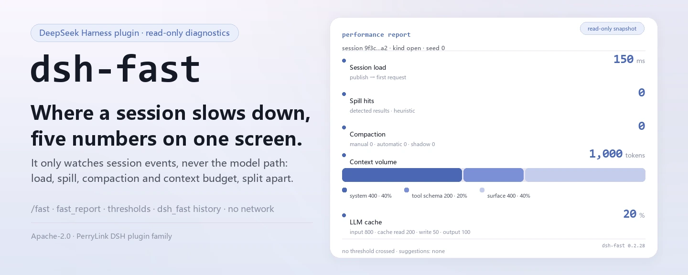
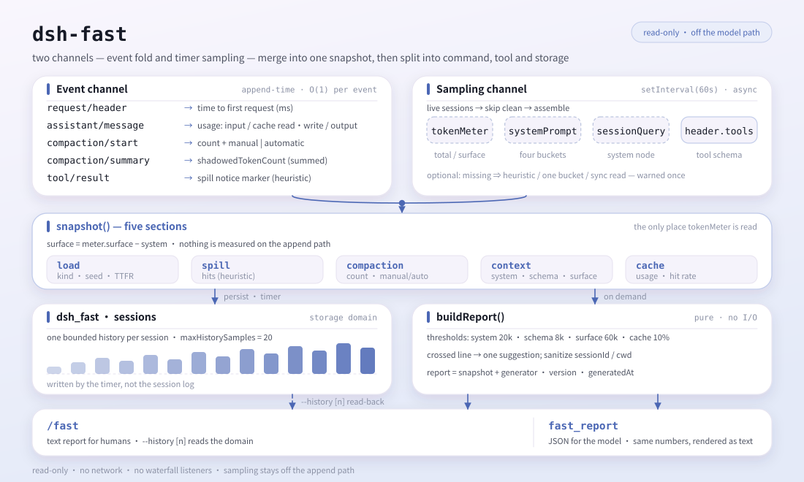

<div align="center">

<picture>
  <source media="(prefers-color-scheme: dark)" srcset="docs/assets/dsh-fast-hero-en-dark.webp">
  
</picture>

# dsh-fast

**एक ही स्क्रीन में देखें कि कोई सत्र कहाँ धीमा पड़ा—विलंबता, संदर्भ बजट और कैश हिट दर।**

DeepSeek Harness के लिए केवल-पढ़ने योग्य प्रदर्शन निदान: सत्र घटना-धारा को देखता है, मॉडल के हॉट पाथ को कभी नहीं, और सत्र लोड, spill, compaction, संदर्भ इंजेक्शन तथा LLM कैश की लागत अलग-अलग दिखाता है।

[इंस्टॉल](#तीन-चरणों-में-शुरुआत) · [कॉन्फ़िगरेशन](#कॉन्फ़िगरेशन) · [FAQ](#faq) · [简体中文](README.md) · [English](README.en.md) · [Español](README.es.md) · [Português](README.pt.md) · [हिन्दी](README.hi.md)

[](LICENSE)
[](#संगतता)
[](https://www.npmjs.com/package/dsh-fast)
[](https://github.com/PerryLink/dsh-fast/actions/workflows/ci.yml)
[](#संगतता)

[](https://github.com/PerryLink/dsh-fast/stargazers)
[](https://www.npmjs.com/package/dsh-fast)
[](https://dshfind.com/plugins/PerryLink/dsh-fast?ref=badge)
[](https://securityscorecards.dev/viewer/?uri=github.com/PerryLink/dsh-fast)
[](https://dsh.market/)
[](https://gitee.com/perrylink/dsh-fast)

```sh
dsh plugin --profile <name> add dsh-fast
```

</div>

<sub>सामुदायिक प्लगइन, DeepSeek से संबद्ध नहीं। एकमात्र रेपो: <https://github.com/PerryLink/dsh-fast> (Gitee एक मिरर है)।</sub>

## यह क्या है

`dsh-fast` एक DeepSeek Harness सत्र का स्वास्थ्य-परीक्षण है: एक `/fast` से सत्र लोड समय, कितने टूल परिणाम spill हुए, कितने compaction चले, संदर्भ बजट system prompt / टूल schema / बातचीत इतिहास में कैसे बँटा है, और LLM कैश हिट दर दिखती है। यह पूर्णतः केवल-पठन है: `session/created`, `session/event` और `session/disposed` सुनता है, हर घटना को O(1) में fold करता है, स्नैपशॉट टाइमर पर लेता है, और मॉडल अनुरोध या टूल परिणाम के किसी waterfall में कभी नहीं घुसता। मेट्रिक्स `dsh_fast` स्टोरेज डोमेन (प्रति सत्र एक सीमित इतिहास) में जाते हैं, सत्र लॉग में नहीं; रिपोर्ट की पहचान और वैकल्पिक कार्य निर्देशिका दिखाने से पहले सैनिटाइज़ की जाती हैं।

<picture>
  <source media="(prefers-color-scheme: dark)" srcset="docs/assets/dsh-fast-flow-v5-dark.svg">
  
</picture>

## तीन चरणों में शुरुआत

1. **इंस्टॉल** (दो चैनल):

   ```sh
   # git चैनल (नवीनतम main; #v0.2.28 से वर्शन पिन करें)
   dsh plugin --profile web add github:PerryLink/dsh-fast
   dsh plugin --profile web add github:PerryLink/dsh-fast#v0.2.28
   # npm चैनल (प्रकाशित वर्शन)
   dsh plugin --profile web add dsh-fast
   ```

   दोनों चैनल bundle पंक्ति (देखें [`cordis.patch.yml`](cordis.patch.yml)) को profile के `dsh.profile.bundles` स्टैक में स्थापित करते हैं; पुनः आरंभ पर प्रभावी होती है।

2. **न्यूनतम कॉन्फ़िगरेशन** (डिफ़ॉल्ट चलते हैं; ज़रूरत हो तभी profile patch की `dsh-fast` पंक्ति पर बदलें):

   ```yaml
   - insert:
       - id: dsh-fast
         name: dsh-fast
         config:
           enabled: true
           thresholds:
             surfaceTokens: 60000
   ```

   हर कुंजी, उसका डिफ़ॉल्ट और अर्थ [`cordis.patch.yml`](cordis.patch.yml) में इनलाइन तथा नीचे कॉन्फ़िगरेशन तालिका में दर्ज है।

3. **जाँचें कि सक्रिय है**:

   ```sh
   dsh --profile demo --dump-config | grep -A2 'id: dsh-fast'
   ```

   पुनः आरंभ के बाद किसी भी सत्र में `/fast` चलाएँ; पहली पंक्ति में `performance report` दिखे तो पंक्ति माउंट है।

**अनइंस्टॉल**: `dsh plugin --profile demo remove dsh-fast` (या profile patch से पंक्ति हटाएँ)।

<details>
<summary>DSH Desktop मार्केट से इंस्टॉल करें</summary>

सभी PerryLink प्लगइन DSH Desktop के अंतर्निहित मार्केट में देखे जा सकते हैं: **Market → Sources → add source → चिपकाएँ** `https://perrylink-dsh-catalog.perrylink.workers.dev/catalog-source.json` **→ चुनें**। इंस्टॉल अब भी मार्केट की npm पहचान जाँच और आपकी पुष्टि से गुज़रता है।

</details>

## मुख्य क्षमताएँ

`dsh-fast` «यह सत्र कहाँ धीमा पड़ा» को पढ़ने योग्य संख्याओं में बदलता है:

- **सत्र लोड समय** — प्रकाशन→पहली अनुरोध विलंबता, `open` (नया) बनाम `restore` (seed/पुनः आरंभ) में वर्गीकृत, साथ में seed घटना गणना।
- **spill हिट गणना** — कितने टूल परिणाम सत्र-स्कोप artifact में spill हुए (स्थायी spill सूचना से पता लगाया गया)।
- **compaction गणना और कारण** — कुल, `manual` (कमांड) बनाम `automatic` (दबाव) में विभाजित, और कुल shadowed टोकन।
- **इंजेक्ट किए गए संदर्भ की मात्रा** — system-prompt (AGENTS.md + skills + persona), टूल schema और सतह टोकन, उनके हिस्सों के साथ; सतह केवल बातचीत इतिहास है (`0.1.5-alpha.1` में meter की सतह में system नोड शामिल होता है, जिसे dsh-fast घटा देता है)।
- **LLM कैश हिट दर** — provider usage से एकत्र input / cache-read / cache-write / output टोकन और व्युत्पन्न दर।
- **अनुकूलन सुझाव** — थ्रेशोल्ड-आधारित (skills छाँटें, टूल schema कसें, पहले compact करें, प्रॉम्प्ट कैश सक्षम करें, spill-policy सक्षम करें…)।
- **इतिहास दृश्य** — `/fast --history [n]` `dsh_fast` डोमेन की अंतिम n अमूर्तियाँ (डिफ़ॉल्ट 10) दिखाता है, ताकि एक बिंदु की जगह रुझान दिखे।
- **अतुल्यकालिक नमूनाकरण** — प्रति घटना O(1) fold; नमूनाकरण टाइमर पर चलता है, append पाथ पर कभी नहीं।

### कमांड और टूल

| सतह | आउटपुट | विवरण |
|---|---|---|
| `/fast` | टेक्स्ट रिपोर्ट | सत्र की स्वास्थ्य रिपोर्ट छापता है: लोड, spill, compaction, संदर्भ-मात्रा रैंकिंग, कैश दर और सुझाव |
| `/fast --history [n]` | टेक्स्ट इतिहास | `dsh_fast` डोमेन का स्थायी नमूना इतिहास छापता है (प्रति सत्र सैंपलिंग टाइमर लिखता है) |
| `fast_report` | संरचित JSON | वही रिपोर्ट लौटाता है (ताकि मॉडल तर्क कर सके), पठनीय टेक्स्ट render के साथ |

### उदाहरण

ये वास्तविक प्रवेश बिंदु हैं; इंस्टॉल के बाद एक चलाएँ।

**विस्तृत उदाहरण** — कमांड `/fast`:

```sh
/fast
```

आउटपुट:

~~~text
dsh-fast 0.1.0 — performance report
session: abc

## Session load
kind: open
seed events: 0
time to first request: 150 ms

## Spill
detected spilled results: 0 (heuristic)

## Compaction
count: 0 (manual: 0, automatic: 0)
shadowed tokens: 0

## Context volume
total: 1000 tokens
system (AGENTS.md/skills/persona): 400 (40%)
tool schema: 200 (20%)
surface: 400 (40%)

## System prompt breakdown
persona: 100 tokens / 400 chars (25%)
skills: 0 tokens / 0 chars (0%)
AGENTS.md: 0 tokens / 0 chars (0%)
other (harness identity + tool guidance): 300 tokens / 1200 chars (75%)

## LLM cache
input: 800, cache read: 200, cache write: 50, output: 100
hit rate: 20%

## Suggestions
- none
~~~

*Observed from `plugins/dsh-fast/src/analyze.ts:88-131; baseline fixture at test/analyze.spec.ts:12-35, 82-100`*

**विफलता शाखा** — इनपुट `/fast --history nope`, आउटपुट:

~~~text
Usage: /fast [--history [n]]
~~~

*Observed from `plugins/dsh-fast/src/index.ts:241-245`*

**संक्षिप्त उदाहरण**: `fast_report`

## कॉन्फ़िगरेशन

सभी ट्यूनेबल Schemastery `Config` फ़ील्ड हैं; अमान्य मान profile लोड को ज़ोर से विफल करते हैं (धनात्मक पूर्णांक सीमाएँ और `0..1` अनुपात जाँचे जाते हैं)। [`cordis.patch.yml`](cordis.patch.yml) हर कुंजी पर इनलाइन टिप्पणी करता है।

सबसे अधिक उपयोग होने वाली कुंजियाँ:

| कुंजी | डिफ़ॉल्ट | अर्थ |
| --- | --- | --- |
| `enabled` | `true` | मुख्य स्विच; `false` पर कुछ नहीं माउंट होता। |
| `privacy.includeCwd` | `false` | रिपोर्ट में सैनिटाइज़्ड कार्य निर्देशिका शामिल करें। |
| `sampling.snapshotIntervalMs` | `60000` | सक्रिय सत्रों का नमूना कितनी बार लिया जाए (ms)। |
| `sampling.maxHistorySamples` | `20` | प्रति सत्र स्थायी इतिहास में रखे गए नमूने। |
| `thresholds.systemPromptTokens` | `20000` | system prompt इन टोकन से अधिक होने पर चेतावनी। |
| `thresholds.surfaceTokens` | `60000` | सतह इन टोकन से अधिक होने पर चेतावनी। |
| `spill.detectSpilledResults` | `true` | स्थायी सूचना मार्कर से spill हुए परिणामों का पता लगाना। |

<details>
<summary>पूरी कॉन्फ़िगरेशन तालिका (11 कुंजियाँ)</summary>

| कुंजी | डिफ़ॉल्ट | अर्थ |
| --- | --- | --- |
| `enabled` | `true` | मुख्य स्विच; `false` पर कुछ नहीं माउंट होता। |
| `privacy.includeCwd` | `false` | रिपोर्ट में सैनिटाइज़्ड कार्य निर्देशिका शामिल करें। |
| `sampling.snapshotIntervalMs` | `60000` | सक्रिय सत्रों का नमूना कितनी बार लिया जाए (ms)। |
| `sampling.maxHistorySamples` | `20` | प्रति सत्र स्थायी इतिहास में रखे गए नमूने। |
| `thresholds.systemPromptTokens` | `20000` | system prompt इन टोकन से अधिक होने पर चेतावनी। |
| `thresholds.toolSchemaTokens` | `8000` | टूल schema इन टोकन से अधिक होने पर चेतावनी। |
| `thresholds.surfaceTokens` | `60000` | सतह इन टोकन से अधिक होने पर चेतावनी। |
| `thresholds.cacheHitRateFloor` | `0.1` | कैश दर इससे (0..1) नीचे जाने पर चेतावनी। |
| `thresholds.compactionCountWarn` | `10` | इतने compaction के बाद चेतावनी। |
| `thresholds.compactionShadowTokens` | `40000` | प्रति summary औसत shadowed टोकन इससे अधिक होने पर चेतावनी। |
| `spill.detectSpilledResults` | `true` | स्थायी सूचना मार्कर से spill हुए परिणामों का पता लगाना। |

</details>

profile patch में ओवरराइड का उदाहरण:

```yaml
- insert:
    - id: dsh-fast
      name: dsh-fast
      config:
        thresholds:
          cacheHitRateFloor: 0.2
        sampling:
          snapshotIntervalMs: 30000
```

## FAQ

<details>
<summary>क्या यह मॉडल को धीमा करता है? ओवरहेड कितना है?</summary>

नहीं। fold `session/event` पर टिका है और प्रति घटना O(1) है; स्नैपशॉट `snapshotIntervalMs` टाइमर (डिफ़ॉल्ट 60 सेकंड) पर बनते हैं, कभी append पाथ या मॉडल-अनुरोध पाथ पर नहीं; `/fast` और `fast_report` सिर्फ़ बुलाए जाने पर रिपोर्ट जोड़ते हैं। यह कोई waterfall listener पंजीकृत नहीं करता और मॉडल अनुरोध, टूल परिणाम या सत्र सतह को कभी नहीं बदलता।

</details>

<details>
<summary>मेट्रिक्स कहाँ रखे जाते हैं? क्या वे सत्र लॉग में जाते हैं या संवेदनशील डेटा लीक करते हैं?</summary>

स्नैपशॉट `dsh_fast` स्टोरेज डोमेन में लिखे जाते हैं (प्रति सत्र एक सीमित इतिहास, `maxHistorySamples` डिफ़ॉल्ट 20) और **कभी सत्र लॉग में नहीं**; कच्ची सत्र घटनाएँ पुनर्निर्माण-योग्य स्रोत बनी रहती हैं। रिपोर्ट का `sessionId` सैनिटाइज़ होता है; `cwd` डिफ़ॉल्ट रूप से नहीं दिखता और `privacy.includeCwd: true` पर भी केवल कटा हुआ पाथ लिखा जाता है; नियंत्रण वर्ण किसी भी प्रदर्शन या स्थायी लेखन से पहले हटाए जाते हैं। प्लगइन कोई नेटवर्क अनुरोध नहीं करता और क्रेडेंशियल नहीं संभालता।

</details>

<details>
<summary>होस्ट की वैकल्पिक सेवाएँ न हों तो क्या होता है? संख्याएँ चुपचाप बदल जाती हैं?</summary>

चुपचाप नहीं बदलतीं। `tokenMeter` न होने पर ह्यूरिस्टिक टोकन मूल्यांकन पर fallback होता है, `systemPrompt` न होने पर पूरा प्रॉम्प्ट एक ही बाल्टी में जाता है, विफल `inspector` आउटलेट अनदेखा होता है—अब इनमें से प्रत्येक प्रति प्रक्रिया एक बार बताता है। `sessionQuery` उपलब्ध न होने पर समतुल्य सिंक्रोनस रीड पर fallback होता है, और विफल रीड की सूचना देकर fallback पाथ लिया जाता है।

</details>

<details>
<summary>`fast/*` सत्र घटनाओं की जगह स्टोरेज डोमेन क्यों?</summary>

rc.2 का `Session.append` `ignorable` मार्कर या बाहरी घटना-पंजीकरण सतह नहीं देता; कस्टम `fast/*` सत्र घटना पुनर्स्थापना पर लॉग को अस्वीकार करवा देती। इसलिए मेट्रिक्स स्टोरेज डोमेन में रहते हैं, और कच्ची सत्र घटनाएँ पुनर्निर्माण-योग्य स्रोत बनी रहती हैं (ज्ञात सीमाएँ देखें)।

</details>

<details>
<summary>क्या यह दूसरे प्लगइनों से कमांड नाम या घटनाओं पर टकराता है?</summary>

ठीक एक ज्ञात टकराव है: यदि दूसरा प्लगइन भी `fast` नाम की **client** `commandUi` योगदान पंजीकृत करता है, तो होस्ट का स्लैश कमांड मेनू पूरा `/` स्रोत छोड़ सकता है। यह टकराव होस्ट के client नामस्थान में है और यह प्लगइन रनटाइम पर नाम नहीं बदल सकता; दूसरे प्लगइन की `fast` client कमांड बंद/नाम बदलें, या एक प्लगइन हटाएँ। इसके अलावा यह एक कमांड, एक टूल, तीन केवल-पठन `session/*` listener और एक स्टोरेज डोमेन पंजीकृत करता है: कोई service नहीं, कोई client slot नहीं, कोई HTTP रूट नहीं।

</details>

## सुरक्षा सीमाएँ

- **केवल-पठन, मॉडल पाथ पर शून्य ओवरहेड** — प्रति घटना O(1) fold; नमूनाकरण टाइमर पर।
- **कोई नेटवर्क नहीं, कोई क्रेडेंशियल संचालन नहीं** — कोई आउटबाउंड अनुरोध या संवेदनशील भंडारण नहीं।
- **ज़ोर से विफल विन्यास** — हर ट्यूनेबल माउंट पर मान्य होता है; अमान्य सीमाएँ त्रुटि देती हैं।
- **सैनिटाइज़्ड प्रदर्शन/स्थायी डेटा** — नियंत्रण वर्ण हटाए जाते हैं और लंबाई सीमित होती है; `cwd` डिफ़ॉल्ट रूप से बंद है।
- **प्रतिवर्ती पंजीकरण** — सब कुछ `ctx.effect()` / `ctx.on()` / `register()` से गुज़रता है, इसलिए अनइंस्टॉल और हॉट रीलोड साफ़ रहते हैं।

## अनुमतियाँ और डेटा

`dsh-fast` केवल सार्वजनिक seams उपभोग करता है: `session/*` और `agent/*` घटनाएँ, वैकल्पिक `ctx.tokenMeter`, `ctx.storageDomain`, `ctx.commands` और `ctx.tools`। यह सत्र लॉग पर पूर्णतः केवल-पठन है — मॉडल अनुरोध, टूल परिणाम या सतह को कभी नहीं बदलता। मेट्रिक्स `dsh_fast` डोमेन (प्रति सत्र एक सीमित इतिहास) में सहेजे जाते हैं, सत्र लॉग में नहीं। रिपोर्ट पहचान और वैकल्पिक निर्देशिका किसी भी प्रदर्शन या स्थायी लेखन से पहले सैनिटाइज़ की जाती हैं।

## ज्ञात सीमाएँ

- **स्टोरेज डोमेन, सत्र घटनाएँ नहीं** — rc.2 का `Session.append` `ignorable` मार्कर या बाहरी घटना-पंजीकरण सतह नहीं देता; कस्टम `fast/*` घटना पुनर्स्थापना पर लॉग को अस्वीकार करवा देती। इसलिए मेट्रिक्स स्टोरेज डोमेन में जाते हैं; कच्ची घटनाएँ पुनर्निर्माण-योग्य स्रोत बनी रहती हैं।
- **spill पहचान अनुमानी है** — यह स्थायी सूचना (`Full … stored at:`) पढ़ती है; कोई समर्पित सत्र घटना नहीं है।
- **system prompt एक ही बकेट है** — AGENTS.md, skills और persona असेंबल किए गए system prompt का हिस्सा हैं; `0.1.5-alpha.1` से यह सतह का नोड 0 (एक `system/message`) है और प्रति-अनुभाग गणना नहीं रखता, इसलिए इन्हें एक साथ रिपोर्ट किया जाता है।
- **लोड समय प्रकाशन से शुरू होता है** — पुनर्स्थापना का डिस्क-रीड `session/created` से पहले होता है (`sessionPersistence` के अधीन) और अनुमत घटनाओं से दिखाई नहीं देता; रिपोर्ट की गई अवधि प्रकाशन→पहली अनुरोध है।
- **गिरावट की सूचना एक बार दी जाती है** — `tokenMeter` न होने पर ह्यूरिस्टिक टोकन मूल्यांकन, `systemPrompt` न होने पर पूरा प्रॉम्प्ट एक ही बाल्टी में, और विफल `inspector` आउटलेट अनदेखा; अब इनमें से प्रत्येक प्रति प्रक्रिया एक बार बताता है, चुपचाप संख्याओं का अर्थ नहीं बदलता।

## अन्य DSH प्लगइनों के साथ इंटरऑपरेबिलिटी

यह README DeepSeek Harness `0.2.1-alpha.1` को लक्षित करता है (समर्थित सीमा के लिए संगतता देखें)। यह प्लगइन ठीक एक कमांड (`/fast`), एक टूल (`fast_report`), तीन केवल-पठन listener (`session/created`, `session/event`, `session/disposed`) और एक `dsh_fast` स्टोरेज डोमेन पंजीकृत करता है: कोई service नहीं देता, कोई client slot पंजीकृत नहीं करता, कोई `webServer` रूट पंजीकृत नहीं करता और किसी waterfall को नहीं सुनता—इसलिए यह मॉडल अनुरोध, टूल परिणाम या सत्र सतह को नहीं बदल सकता, और किसी दूसरे प्लगइन के हॉट पाथ में भाग नहीं लेता।

एकमात्र ज्ञात टकराव होस्ट के client कमांड नामस्थान में है: `/fast` होस्ट कमांड नाम है, और यदि दूसरा प्लगइन भी `fast` नाम की **client** `commandUi` योगदान पंजीकृत करता है, तो स्लैश कमांड मेनू पूरा `/` स्रोत छोड़ सकता है। यह प्लगइन रनटाइम पर नाम बदलकर इसे टाल नहीं सकता। उपाय: दूसरे प्लगइन की `fast` client कमांड बंद/नाम बदलें, या एक प्लगइन हटाएँ। बिना डुप्लिकेट client योगदान के `/fast` और `fast_report` काम करते हैं।

## संगतता

| आयाम | स्थिति |
|---|---|
| Harness | DeepSeek Harness `dsh-v0.2.1-alpha.1` (2026-09-18 को अनुकूलित): सत्र सतह अब वैकल्पिक `sessionQuery` सेवा से पढ़ी जाती है — पदावनत सिंक्रोनस `Session.eventAt(seq)` एक्सेसर हट गया और उसकी जगह समतुल्य सिंक्रोनस रीड fallback है — और सभी रजिस्ट्रेशन अब एक ही lifecycle effect में रहते हैं जो उन्हें उल्टे क्रम में मुक्त करता है। आंतरिक बदलाव: एक ही लॉग पर मेट्रिक्स बिल्कुल समान रहते हैं। 2026-10-04 को स्थानीय गेट शृंखला (तीन typecheck + 71 टेस्ट) से सत्यापित; compat workflow प्रकाशित pins के साथ profile इंस्टॉल स्मोक दोहराता है। |
| Node | `^22.19.0 \|\| >=24.0.0`, केवल ESM (`"type": "module"`)। |
| प्लेटफ़ॉर्म | जहाँ DSH चलता है (शुद्ध host; कोई नेटवर्क नहीं, कोई ब्राउज़र-आधा नहीं)। |
| मॉडल | टेक्स्ट मॉडल पर्याप्त है; `fast_report` संरचित JSON लौटाता है और अतिरिक्त मॉडल क्षमता नहीं माँगता। |

peer निर्भरताएँ: `@deepseek-ai/cordis ^4.0.2`, `@deepseek-ai/schemastery ^3.18.4`, और `@deepseek-ai/dsh-session`, `@deepseek-ai/dsh-tools`, `@deepseek-ai/dsh-commands`, `@deepseek-ai/dsh-compaction`, `@deepseek-ai/dsh-session-query`, `@deepseek-ai/dsh-storage-domain` (`>=0.1.2-rc.1 <0.2.0 || >=0.1.5-alpha.1 <0.2.0 || >=0.1.6-0 <0.2.0 || >=0.1.7-0 <0.2.0 || >=0.2.0-0 <0.3.0 || >=0.2.1-0 <0.3.0`; devDependencies `0.2.1-rc.2` पर पिन); `0.1.2-rc.1` पंक्ति रनटाइम पर pre-0.1.5 `header.system` के संरचनात्मक fallback से अभी भी समर्थित है।

## इकोसिस्टम और गुणवत्ता

- [Gitee मिरर](https://gitee.com/perrylink/dsh-fast) (समन्वित मिरर; GitHub आधिकारिक स्रोत है)
- [dshfind प्लगइन पेज](https://dshfind.com/plugins/PerryLink/dsh-fast) (इंस्टॉल और रैंकिंग)
- [OpenSSF Scorecard रिपोर्ट](https://securityscorecards.dev/viewer/?uri=github.com/PerryLink/dsh-fast) ([.github/workflows/scorecard.yml](.github/workflows/scorecard.yml) द्वारा संचालित)
- [dsh-plugin-doctor सत्यापन रिपोर्ट](https://github.com/PerryLink/dsh-plugin-doctor#verified-徽章)
- [DSH Market](https://dsh.market/) (सूचीबद्ध)
- **1024 स्टोर चैनल**: एक बार `npm i -g dsh1024`, फिर `dsh1024 plugin --profile web add dsh-fast` ([deepseek1024.com](https://deepseek1024.com) इंस्टॉल रैंकिंग में गिना जाता है)
- [इकोसिस्टम नॉलेज बेस](https://perrylink.github.io/dsh-plugin-guide/): प्लगइन डेवलपमेंट गाइड · चयन डेटा · रखरखाव मानदंड

## डेवलपमेंट

```sh
pnpm install
pnpm run typecheck && pnpm run typecheck:ci && pnpm run typecheck:checkout
pnpm test
pnpm run build
pnpm run verify:self-contained && pnpm run verify:artifacts
node scripts/check-readme-sync.mjs
pnpm pack
```

README की छवियाँ [`scripts/gen-readme-assets.py`](scripts/gen-readme-assets.py) से बनती हैं (hero रास्टर Pillow से, संरचना-चित्र हाथ से लिखे SVG से); यह `docs/assets/dsh-fast-hero-{zh,en}-{light,dark}.webp` और `docs/assets/dsh-fast-flow-v5-{light,dark}.svg` लिखता है और idempotent है। पुराने एक-थीम `docs/assets/dsh-fast-flow.svg`, `dsh-fast-flow-{light,dark}.svg`, `dsh-fast-hero.png` और `dsh-fast-demo.*` बाहरी लिंक के 404 से बचने के लिए वहीं रखे गए हैं; README अब उन्हें संदर्भित नहीं करते।

Topics: `dsh`, `dsh-plugin`, `deepseek-harness`, `deepseek`, `cordis`, `performance`, `diagnostics`, `profiling`, `context-engineering`, `llm-cache`

## परिवार और आभार

यह प्रोजेक्ट [PerryLink](https://github.com/PerryLink) द्वारा अनुरक्षित DeepSeek Harness प्लगइन परिवार का हिस्सा है (सभी Apache-2.0)। अगर यह प्लगइन उपयोगी लगे, तो **एक स्टार दें** — इससे कोई सुविधा अनलॉक नहीं होती, पर अगला व्यक्ति इसे जल्दी पा लेता है।

- [@PerryLink](https://github.com/PerryLink) — लेखक और अनुरक्षक: रीड-ओनली डायग्नोस्टिक्स (सेशन-लोड विलंब, स्पिल-हिट गणना, कम्पैक्शन मीट्रिक्स, कॉन्टेक्स्ट-इंजेक्शन वॉल्यूम, LLM कैश हिट रेट), `/fast` कमांड और `fast_report` टूल, `dsh_fast` स्टोरेज डोमेन तथा पाँच-भाषा दस्तावेज़ का डिज़ाइन व निर्माण किया।

<details>
<summary>सभी प्लगइन खोलें</summary>

| प्लगइन | स्थिति |
|---|---|
| **[dsh-aqua-input-check](https://github.com/PerryLink/dsh-aqua-input-check)** |  |
| **[dsh-archive-check](https://github.com/PerryLink/dsh-archive-check)** |  |
| **[dsh-auto-review](https://github.com/PerryLink/dsh-auto-review)** |  |
| **[dsh-autotier](https://github.com/PerryLink/dsh-autotier)** | 🧊 फ़्रोज़न — रेपो README देखें |
| **[dsh-bid-ca-precheck](https://github.com/PerryLink/dsh-bid-ca-precheck)** |  |
| **[dsh-bid-qual-check](https://github.com/PerryLink/dsh-bid-qual-check)** |  |
| **[dsh-cert-mcp](https://github.com/PerryLink/dsh-cert-mcp)** | 🧊 फ़्रोज़न — रेपो README देखें |
| **[dsh-checkpoint-rewind](https://github.com/PerryLink/dsh-checkpoint-rewind)** |  |
| **[dsh-click](https://github.com/PerryLink/dsh-click)** |  |
| **[dsh-composer-history](https://github.com/PerryLink/dsh-composer-history)** |  |
| **[dsh-contract-stance](https://github.com/PerryLink/dsh-contract-stance)** |  |
| **[dsh-customs-doc-check](https://github.com/PerryLink/dsh-customs-doc-check)** |  |
| **[dsh-data-quality](https://github.com/PerryLink/dsh-data-quality)** | 🧊 फ़्रोज़न — रेपो README देखें |
| **[dsh-demurrage-ledger](https://github.com/PerryLink/dsh-demurrage-ledger)** |  |
| **[dsh-doublecheck](https://github.com/PerryLink/dsh-doublecheck)** |  |
| **[dsh-drill-script-check](https://github.com/PerryLink/dsh-drill-script-check)** |  |
| **[dsh-eia-guide-check](https://github.com/PerryLink/dsh-eia-guide-check)** |  |
| **[dsh-emergency-plan](https://github.com/PerryLink/dsh-emergency-plan)** |  |
| **[dsh-essay-rubric-check](https://github.com/PerryLink/dsh-essay-rubric-check)** |  |
| **[dsh-evidence-check](https://github.com/PerryLink/dsh-evidence-check)** |  |
| **[dsh-export-ctl-check](https://github.com/PerryLink/dsh-export-ctl-check)** |  |
| **[dsh-fast](https://github.com/PerryLink/dsh-fast)** |  |
| **[dsh-fmea-table-check](https://github.com/PerryLink/dsh-fmea-table-check)** |  |
| **[dsh-forecast-penalty](https://github.com/PerryLink/dsh-forecast-penalty)** |  |
| **[dsh-fund-research](https://github.com/PerryLink/dsh-fund-research)** |  |
| **[dsh-github](https://github.com/PerryLink/dsh-github)** |  |
| **[dsh-gongwen-flow-check](https://github.com/PerryLink/dsh-gongwen-flow-check)** |  |
| **[dsh-gongwen-word-check](https://github.com/PerryLink/dsh-gongwen-word-check)** |  |
| **[dsh-guard-plan-qc](https://github.com/PerryLink/dsh-guard-plan-qc)** |  |
| **[dsh-hazchem-check](https://github.com/PerryLink/dsh-hazchem-check)** |  |
| **[dsh-hazplan-check](https://github.com/PerryLink/dsh-hazplan-check)** |  |
| **[dsh-hidden-risk-map](https://github.com/PerryLink/dsh-hidden-risk-map)** |  |
| **[dsh-hs-classify](https://github.com/PerryLink/dsh-hs-classify)** |  |
| **[dsh-icd-rule-check](https://github.com/PerryLink/dsh-icd-rule-check)** |  |
| **[dsh-industry-research](https://github.com/PerryLink/dsh-industry-research)** |  |
| **[dsh-lawcite-adapter](https://github.com/PerryLink/dsh-lawcite-adapter)** |  |
| **[dsh-laya](https://github.com/PerryLink/dsh-laya)** |  |
| **[dsh-lc-doc-check](https://github.com/PerryLink/dsh-lc-doc-check)** |  |
| **[dsh-learning-gap-check](https://github.com/PerryLink/dsh-learning-gap-check)** |  |
| **[dsh-library](https://github.com/PerryLink/dsh-library)** |  |
| **[dsh-local-ai](https://github.com/PerryLink/dsh-local-ai)** |  |
| **[dsh-lsp-actions](https://github.com/PerryLink/dsh-lsp-actions)** |  |
| **[dsh-mask](https://github.com/PerryLink/dsh-mask)** |  |
| **[dsh-mcp-panel](https://github.com/PerryLink/dsh-mcp-panel)** |  |
| **[dsh-medrec-qc](https://github.com/PerryLink/dsh-medrec-qc)** |  |
| **[dsh-memento](https://github.com/PerryLink/dsh-memento)** | 🧊 फ़्रोज़न — रेपो README देखें |
| **[dsh-nsfc-form-check](https://github.com/PerryLink/dsh-nsfc-form-check)** |  |
| **[dsh-nurse-record-check](https://github.com/PerryLink/dsh-nurse-record-check)** |  |
| **[dsh-observe](https://github.com/PerryLink/dsh-observe)** |  |
| **[dsh-origin-rvc-check](https://github.com/PerryLink/dsh-origin-rvc-check)** |  |
| **[dsh-ota-review-check](https://github.com/PerryLink/dsh-ota-review-check)** |  |
| **[dsh-output-styles](https://github.com/PerryLink/dsh-output-styles)** |  |
| **[dsh-paper-doc-adapter](https://github.com/PerryLink/dsh-paper-doc-adapter)** |  |
| **[dsh-permission-rules](https://github.com/PerryLink/dsh-permission-rules)** |  |
| **[dsh-permit-report-check](https://github.com/PerryLink/dsh-permit-report-check)** |  |
| **[dsh-pipeline-check](https://github.com/PerryLink/dsh-pipeline-check)** |  |
| **[dsh-pleading-draft](https://github.com/PerryLink/dsh-pleading-draft)** |  |
| **[dsh-plugin-doctor](https://github.com/PerryLink/dsh-plugin-doctor)** | 🚫 रिटायर्ड (रेपो संग्रहीत) |
| **[dsh-plugin-guide](https://github.com/PerryLink/dsh-plugin-guide)** |  |
| **[dsh-plugin-kit](https://github.com/PerryLink/dsh-plugin-kit)** | 🚫 रिटायर्ड (रेपो संग्रहीत) |
| **[dsh-plugin-upgrade](https://github.com/PerryLink/dsh-plugin-upgrade)** | 🚫 रिटायर्ड (रेपो संग्रहीत) |
| **[dsh-policy-brief-draft](https://github.com/PerryLink/dsh-policy-brief-draft)** |  |
| **[dsh-power-loss-split](https://github.com/PerryLink/dsh-power-loss-split)** |  |
| **[dsh-power-ticket-check](https://github.com/PerryLink/dsh-power-ticket-check)** |  |
| **[dsh-ppap-check](https://github.com/PerryLink/dsh-ppap-check)** |  |
| **[dsh-protest-deadline](https://github.com/PerryLink/dsh-protest-deadline)** |  |
| **[dsh-railway-window](https://github.com/PerryLink/dsh-railway-window)** |  |
| **[dsh-repair-order-qc](https://github.com/PerryLink/dsh-repair-order-qc)** |  |
| **[dsh-research-report](https://github.com/PerryLink/dsh-research-report)** |  |
| **[dsh-review-reply-check](https://github.com/PerryLink/dsh-review-reply-check)** |  |
| **[dsh-rulefile-check](https://github.com/PerryLink/dsh-rulefile-check)** |  |
| **[dsh-safety-brief-check](https://github.com/PerryLink/dsh-safety-brief-check)** |  |
| **[dsh-score](https://github.com/PerryLink/dsh-score)** | 🧊 फ़्रोज़न — रेपो README देखें |
| **[dsh-session-sync](https://github.com/PerryLink/dsh-session-sync)** |  |
| **[dsh-site-log-check](https://github.com/PerryLink/dsh-site-log-check)** |  |
| **[dsh-skill-pack-security](https://github.com/PerryLink/dsh-skill-pack-security)** |  |
| **[dsh-soe-decision-check](https://github.com/PerryLink/dsh-soe-decision-check)** |  |
| **[dsh-soilwater-check](https://github.com/PerryLink/dsh-soilwater-check)** |  |
| **[dsh-sop-sync-check](https://github.com/PerryLink/dsh-sop-sync-check)** |  |
| **[dsh-spc-gbt-adapter](https://github.com/PerryLink/dsh-spc-gbt-adapter)** |  |
| **[dsh-talk](https://github.com/PerryLink/dsh-talk)** |  |
| **[dsh-tender-extract](https://github.com/PerryLink/dsh-tender-extract)** |  |
| **[dsh-tender-matrix](https://github.com/PerryLink/dsh-tender-matrix)** |  |
| **[dsh-test-drive](https://github.com/PerryLink/dsh-test-drive)** |  |
| **[dsh-ticktick](https://github.com/PerryLink/dsh-ticktick)** | 🚫 रिटायर्ड (रेपो संग्रहीत) |
| **[dsh-translate](https://github.com/PerryLink/dsh-translate)** |  |
| **[dsh-warranty-calc](https://github.com/PerryLink/dsh-warranty-calc)** |  |
| **[dsh-budget](https://github.com/PerryLink/dsh-budget)** | 🧊 फ़्रोज़न — रेपो README देखें |
| **[dsh-claude-move](https://github.com/PerryLink/dsh-claude-move)** | 🧊 फ़्रोज़न — रेपो README देखें |
| **[dsh-defend](https://github.com/PerryLink/dsh-defend)** | 🧊 फ़्रोज़न — रेपो README देखें |
| **[dsh-draw](https://github.com/PerryLink/dsh-draw)** | 🧊 फ़्रोज़न — रेपो README देखें |
| **[dsh-reach](https://github.com/PerryLink/dsh-reach)** | 🧊 फ़्रोज़न — रेपो README देखें |
| **[dsh-background-agents](https://github.com/PerryLink/dsh-background-agents)** | 🚫 रिटायर्ड (रेपो संग्रहीत) |
| **[dsh-session-pin](https://github.com/PerryLink/dsh-session-pin)** | 🚫 रिटायर्ड (रेपो संग्रहीत) |
| **[dsh-team-rooms](https://github.com/PerryLink/dsh-team-rooms)** | 🚫 रिटायर्ड (रेपो संग्रहीत) |

</details>

## लाइसेंस

[LICENSE](LICENSE) (Apache License 2.0) © 2026 dsh-fast contributors

<p align="center"><sub>Apache-2.0 · सामुदायिक प्लगइन, DeepSeek से संबद्ध नहीं।</sub></p>
