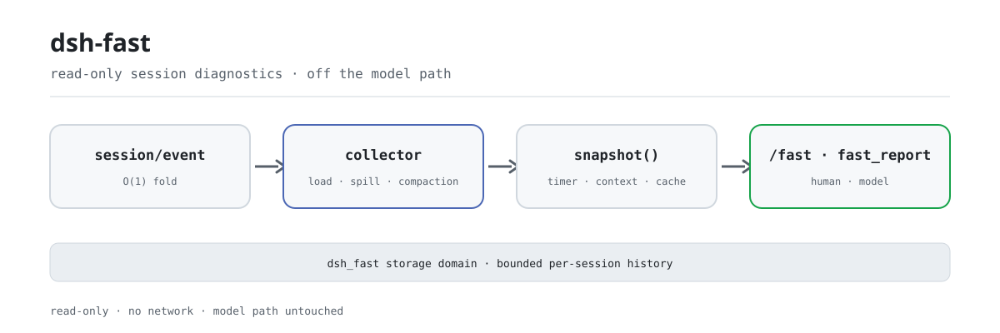

<div align="center">

<picture>
  <source media="(prefers-color-scheme: dark)" srcset="docs/assets/dsh-fast-flow-dark.svg">
  
</picture>

# dsh-fast

**Descubra onde uma sessão desacelerou—latência, orçamento de contexto e taxa de acertos do cache em uma única tela.**

Diagnóstico de desempenho somente leitura para DeepSeek Harness: observa o fluxo de eventos da sessão, nunca o caminho quente do modelo, e detalha carga da sessão, spill, compactação, injeção de contexto e custo do cache LLM.

[Instalar](#instalação-em-três-passos) · [Configuração](#configuração) · [FAQ](#faq) · [简体中文](README.md) · [English](README.en.md) · [Español](README.es.md) · [Português](README.pt.md) · [हिन्दी](README.hi.md)

[](LICENSE)
[](#compatibilidade)
[](https://www.npmjs.com/package/dsh-fast)
[](https://github.com/PerryLink/dsh-fast/actions/workflows/ci.yml)
[](#compatibilidade)

[](https://github.com/PerryLink/dsh-fast/stargazers)
[](https://www.npmjs.com/package/dsh-fast)
[](https://dshfind.com/plugins/PerryLink/dsh-fast?ref=badge)
[](https://securityscorecards.dev/viewer/?uri=github.com/PerryLink/dsh-fast)
[](https://dsh.market/)
[](https://gitee.com/perrylink/dsh-fast)

```sh
dsh plugin --profile <name> add dsh-fast
```

</div>

<sub>Plugin da comunidade, não afiliado ao DeepSeek. Único repositório: <https://github.com/PerryLink/dsh-fast> (o Gitee é um espelho).</sub>

## O que é

`dsh-fast` é um check-up de uma sessão do DeepSeek Harness: um único `/fast` mostra o tempo de carga da sessão, quantos resultados de ferramenta foram derramados (spill), quantas compactações dispararam, como o orçamento de contexto se divide entre system prompt / schema de ferramentas / histórico da conversa e a taxa de acertos do cache LLM. É estritamente somente leitura: escuta `session/created`, `session/event` e `session/disposed`, dobra cada evento em O(1), amostra snapshots em um timer e nunca entra no waterfall da requisição do modelo nem dos resultados de ferramentas. As métricas são gravadas no domínio de armazenamento `dsh_fast` (um histórico limitado por sessão), não no log da sessão; a identidade do relatório e o diretório de trabalho opcional são saneados antes de exibir.

## Instalação em três passos

1. **Instalar** (dois canais):

   ```sh
   # canal git (main mais recente; fixe uma versão com #v0.2.28)
   dsh plugin --profile web add github:PerryLink/dsh-fast
   dsh plugin --profile web add github:PerryLink/dsh-fast#v0.2.28
   # canal npm (versão publicada)
   dsh plugin --profile web add dsh-fast
   ```

   Ambos os canais instalam a linha do bundle (ver [`cordis.patch.yml`](cordis.patch.yml)) na pilha `dsh.profile.bundles` do profile; surte efeito ao reiniciar.

2. **Configuração mínima** (os padrões funcionam; sobrescreva na linha `dsh-fast` do patch do profile apenas se precisar):

   ```yaml
   - insert:
       - id: dsh-fast
         name: dsh-fast
         config:
           enabled: true
           thresholds:
             surfaceTokens: 60000
   ```

   Cada chave, seu padrão e seu significado estão documentados em linha no [`cordis.patch.yml`](cordis.patch.yml) e na tabela de configuração abaixo.

3. **Verificar se está ativo**:

   ```sh
   dsh --profile demo --dump-config | grep -A2 'id: dsh-fast'
   ```

   Após reiniciar, execute `/fast` em qualquer sessão; se a primeira linha contiver `performance report`, a linha está montada.

**Desinstalar**: `dsh plugin --profile demo remove dsh-fast` (ou apague a linha do patch do profile).

<details>
<summary>Instalar a partir do mercado do DSH Desktop</summary>

Todos os plugins PerryLink podem ser explorados no mercado integrado do DSH Desktop: **Market → Sources → add source → colar** `https://perrylink-dsh-catalog.perrylink.workers.dev/catalog-source.json` **→ selecionar**. A instalação continua passando pela verificação de identidade npm do mercado e pela sua confirmação.

</details>

## Capacidades principais

O `dsh-fast` transforma «onde esta sessão desacelerou» em números legíveis:

- **Tempo de carga da sessão** — latência publicação→primeira requisição, classificada `open` (nova) ou `restore` (com semente/retomada), mais a contagem de eventos de semente.
- **Contagem de spill** — quantos resultados de ferramenta foram descarregados em um artefato de sessão (detectado pelo aviso persistente de spill).
- **Contagem e motivo de compactação** — total, separado `manual` (comando) vs `automatic` (pressão), e total de tokens sombreados.
- **Volume de contexto injetado** — tokens de system-prompt (AGENTS.md + skills + persona), schema de ferramentas e superfície, com suas proporções; a superfície é apenas histórico de conversa (no `0.1.5-alpha.1` a superfície do meter inclui o nó de sistema, que o dsh-fast desconta).
- **Taxa de acertos do cache LLM** — tokens input / cache-read / cache-write / output agregados e a taxa derivada.
- **Sugestões de otimização** — baseadas em limiares (cortar skills, ajustar schemas, compactar antes, ativar cache de prompts, ativar spill-policy…).
- **Visão do histórico** — `/fast --history [n]` imprime as últimas n amostras do domínio `dsh_fast` (10 por padrão), para ver a tendência em vez de um único ponto.
- **Amostragem assíncrona** — dobra O(1) por evento; a amostragem roda em um timer, nunca no caminho de append.

### Comandos e ferramentas

| Superfície | Saída | Descrição |
|---|---|---|
| `/fast` | Relatório de texto | Imprime o relatório de saúde da sessão: carga, spill, compactação, ranking de volume de contexto, taxa de cache e sugestões |
| `/fast --history [n]` | Histórico de texto | Imprime o histórico durável de amostras do domínio `dsh_fast` (gravado por sessão pelo timer de amostragem) |
| `fast_report` | JSON estruturado | Devolve o mesmo relatório (para o modelo raciocinar), com render de texto legível |

### Exemplos

São os pontos de entrada reais; instale e chame um.

**Exemplo detalhado** — comando `/fast`:

```sh
/fast
```

Saída:

~~~text
dsh-fast 0.1.0 — performance report
session: abc

## Session load
kind: open
seed events: 0
time to first request: 150 ms

## Spill
detected spilled results: 0 (heuristic)

## Compaction
count: 0 (manual: 0, automatic: 0)
shadowed tokens: 0

## Context volume
total: 1000 tokens
system (AGENTS.md/skills/persona): 400 (40%)
tool schema: 200 (20%)
surface: 400 (40%)

## System prompt breakdown
persona: 100 tokens / 400 chars (25%)
skills: 0 tokens / 0 chars (0%)
AGENTS.md: 0 tokens / 0 chars (0%)
other (harness identity + tool guidance): 300 tokens / 1200 chars (75%)

## LLM cache
input: 800, cache read: 200, cache write: 50, output: 100
hit rate: 20%

## Suggestions
- none
~~~

*Observed from `plugins/dsh-fast/src/analyze.ts:88-131; baseline fixture at test/analyze.spec.ts:12-35, 82-100`*

**Ramo de falha** — entrada `/fast --history nope`, saída:

~~~text
Usage: /fast [--history [n]]
~~~

*Observed from `plugins/dsh-fast/src/index.ts:241-245`*

**Exemplos breves**: `fast_report`

## Configuração

Todos os ajustes são campos Schemastery `Config`; valores inválidos falham a carga do profile de forma audível (inteiros positivos e proporções `0..1` são validados). O [`cordis.patch.yml`](cordis.patch.yml) comenta cada chave em linha.

Chaves mais usadas:

| Chave | Padrão | Significado |
| --- | --- | --- |
| `enabled` | `true` | Interruptor mestre; `false` não monta nada. |
| `privacy.includeCwd` | `false` | Incluir o diretório de trabalho saneado nos relatórios. |
| `sampling.snapshotIntervalMs` | `60000` | A cada quanto as sessões ativas são amostradas (ms). |
| `sampling.maxHistorySamples` | `20` | Amostras retidas por sessão no histórico durável. |
| `thresholds.systemPromptTokens` | `20000` | Avisar se o system prompt exceder esses tokens. |
| `thresholds.surfaceTokens` | `60000` | Avisar se a superfície exceder esses tokens. |
| `spill.detectSpilledResults` | `true` | Detectar resultados descarregados pelo marcador de aviso persistente. |

<details>
<summary>Tabela completa de configuração (11 chaves)</summary>

| Chave | Padrão | Significado |
| --- | --- | --- |
| `enabled` | `true` | Interruptor mestre; `false` não monta nada. |
| `privacy.includeCwd` | `false` | Incluir o diretório de trabalho saneado nos relatórios. |
| `sampling.snapshotIntervalMs` | `60000` | A cada quanto as sessões ativas são amostradas (ms). |
| `sampling.maxHistorySamples` | `20` | Amostras retidas por sessão no histórico durável. |
| `thresholds.systemPromptTokens` | `20000` | Avisar se o system prompt exceder esses tokens. |
| `thresholds.toolSchemaTokens` | `8000` | Avisar se o schema de ferramentas exceder esses tokens. |
| `thresholds.surfaceTokens` | `60000` | Avisar se a superfície exceder esses tokens. |
| `thresholds.cacheHitRateFloor` | `0.1` | Avisar se a taxa de cache cair abaixo disso (0..1). |
| `thresholds.compactionCountWarn` | `10` | Avisar após tantas compactações. |
| `thresholds.compactionShadowTokens` | `40000` | Avisar se a média de tokens sombreados por summary exceder isso. |
| `spill.detectSpilledResults` | `true` | Detectar resultados descarregados pelo marcador de aviso persistente. |

</details>

Exemplo de sobrescrita no patch do profile:

```yaml
- insert:
    - id: dsh-fast
      name: dsh-fast
      config:
        thresholds:
          cacheHitRateFloor: 0.2
        sampling:
          snapshotIntervalMs: 30000
```

## FAQ

<details>
<summary>Isso deixa o modelo mais lento? Qual é a sobrecarga?</summary>

Não. A dobra fica em `session/event` e é O(1) por evento; os snapshots são produzidos no timer `snapshotIntervalMs` (60 segundos por padrão), nunca no caminho de append nem no da requisição do modelo; `/fast` e `fast_report` só montam um relatório quando invocados. Não registra listeners waterfall e nunca altera a requisição do modelo, os resultados de ferramentas ou a superfície da sessão.

</details>

<details>
<summary>Onde as métricas ficam? Entram no log da sessão ou vazam dados sensíveis?</summary>

Os snapshots são gravados no domínio de armazenamento `dsh_fast` (um histórico limitado por sessão; `maxHistorySamples` é 20 por padrão) e **nunca no log da sessão**; os eventos crus da sessão continuam sendo a fonte reconstruível. O `sessionId` do relatório é saneado; `cwd` não aparece por padrão e, com `privacy.includeCwd: true`, apenas o caminho truncado é emitido; caracteres de controle são removidos antes de qualquer exibição ou gravação durável. O plugin não faz requisições de rede nem lida com credenciais.

</details>

<details>
<summary>O que acontece se faltarem serviços opcionais do host? Os números mudam em silêncio?</summary>

Não mudam em silêncio. Sem `tokenMeter` cai no preço heurístico de tokens; sem `systemPrompt` todo o prompt é atribuído a um único balde; uma saída `inspector` que falha é ignorada; cada caso agora avisa uma vez por processo. Quando `sessionQuery` não está disponível usa-se uma leitura síncrona equivalente, e uma leitura falha é anunciada e segue o caminho de fallback.

</details>

<details>
<summary>Por que um domínio de armazenamento e não eventos de sessão `fast/*`?</summary>

O `Session.append` do rc.2 não oferece marcador `ignorable` nem superfície de registro de eventos externa; um evento `fast/*` faria o coordenador de persistência recusar o log ao restaurar. Por isso as métricas vivem no domínio de armazenamento e os eventos crus da sessão continuam sendo a fonte reconstruível (ver Limitações conhecidas).

</details>

<details>
<summary>Há conflito com outros plugins por nomes de comando ou eventos?</summary>

Há exatamente um conflito conhecido: se outro plugin registrar uma contribuição **client** `commandUi` com o mesmo nome `fast`, o menu de comandos pode perder toda a fonte `/`. A colisão está no namespace client do host e este plugin não consegue renomear em runtime; desative/renomeie o comando client `fast` do outro plugin, ou remova um dos plugins. Fora isso, registra um comando, uma ferramenta, três listeners `session/*` somente leitura e um domínio de armazenamento: sem serviços, sem slots client, sem rotas HTTP.

</details>

## Limites de segurança

- **Somente leitura, zero sobrecarga no caminho do modelo** — dobra O(1) por evento; amostragem por timer.
- **Sem rede, sem manuseio de credenciais** — nenhuma requisição de saída nem armazenamento sensível.
- **Configuração que falha audível** — cada ajuste é validado na montagem; limites inválidos lançam erro.
- **Dados de exibição/duráveis saneados** — caracteres de controle são removidos e comprimentos limitados; `cwd` fica desativado por padrão.
- **Registros reversíveis** — tudo passa por `ctx.effect()` / `ctx.on()` / `register()`, então desinstalar e recarregar a quente fica limpo.

## Permissões e dados

O `dsh-fast` consome apenas seams públicos: eventos `session/*` e `agent/*`, o opcional `ctx.tokenMeter`, `ctx.storageDomain`, `ctx.commands` e `ctx.tools`. É estritamente somente leitura sobre o log de sessão — nunca altera a requisição do modelo, os resultados de ferramentas nem a superfície. As métricas são persistidas no domínio `dsh_fast` (um histórico limitado por sessão), não no log. A identidade do relatório e o diretório opcional são saneados antes de exibição ou gravação durável.

## Limitações conhecidas

- **Domínio de armazenamento, não eventos de sessão** — o `Session.append` do rc.2 não oferece marcador `ignorable` nem superfície de registro de eventos externa; um evento `fast/*` faria o coordenador de persistência recusar o log ao restaurar. As métricas vão ao domínio de armazenamento; os eventos crus seguem como fonte reconstruível.
- **A detecção de spill é heurística** — lê o aviso persistente (`Full … stored at:`); não há evento de sessão dedicado.
- **O system prompt é um único balde** — AGENTS.md, skills e persona formam o system prompt montado; desde `0.1.5-alpha.1` é o nó 0 da superfície (um `system/message`) e não traz contagem por seção, então são reportados juntos.
- **O tempo de carga começa na publicação** — a leitura de disco de uma restauração ocorre antes de `session/created` (responsabilidade de `sessionPersistence`) e não é observável pelos eventos permitidos; a duração reportada é publicação→primeira requisição.
- **As degradações são anunciadas uma vez** — um host sem `tokenMeter` cai no preço heurístico de tokens, um host sem `systemPrompt` atribui todo o prompt a um único balde, e uma saída `inspector` que falha é ignorada; cada caso agora avisa uma vez por processo em vez de mudar o significado dos números em silêncio.

## Interoperabilidade com outros plugins DSH

Este README mira o DeepSeek Harness `0.2.1-alpha.1` (ver Compatibilidade para o intervalo suportado). Este plugin registra exatamente um comando (`/fast`), uma ferramenta (`fast_report`), três listeners somente leitura (`session/created`, `session/event`, `session/disposed`) e um domínio de armazenamento `dsh_fast`: não fornece serviços, não registra slots client, não registra rotas `webServer` e não escuta nenhum waterfall; portanto não pode reescrever a requisição do modelo, os resultados de ferramentas ou a superfície da sessão, e não participa do caminho quente de nenhum outro plugin.

O único conflito conhecido está no namespace client do host: `/fast` é um nome de comando do host e, se outro plugin registrar uma contribuição **client** `commandUi` chamada `fast`, o menu de comandos pode perder toda a fonte `/`. Este plugin não consegue renomear em runtime para evitar isso. Solução: desative/renomeie o comando client `fast` do outro plugin, ou remova um dos plugins. `/fast` e `fast_report` continuam funcionando sem uma contribuição client duplicada.

## Compatibilidade

| Dimensão | Estado |
|---|---|
| Harness | DeepSeek Harness `dsh-v0.2.1-alpha.1` (adaptado em 2026-09-18): a superfície da sessão é lida pelo serviço opcional `sessionQuery` — o acessor síncrono obsoleto `Session.eventAt(seq)` sai de cena, com uma leitura síncrona equivalente como fallback — e todos os registros agora vivem em um único efeito de ciclo de vida que os libera em ordem inversa. Mudança interna: as métricas são idênticas para o mesmo log. Verificado em 2026-10-04 com a cadeia de portas local (typecheck triplo + 71 testes); o workflow compat repete o smoke de instalação de profile com os pins publicados. |
| Node | `^22.19.0 \|\| >=24.0.0`, somente ESM (`"type": "module"`). |
| Plataforma | Onde o DSH rodar (host puro; sem rede, sem metade de navegador). |
| Modelo | Um modelo de texto basta; `fast_report` devolve JSON estruturado e não exige capacidades extras. |

Dependências peer: `@deepseek-ai/cordis ^4.0.2`, `@deepseek-ai/schemastery ^3.18.4`, e `@deepseek-ai/dsh-session`, `@deepseek-ai/dsh-tools`, `@deepseek-ai/dsh-commands`, `@deepseek-ai/dsh-compaction`, `@deepseek-ai/dsh-session-query`, `@deepseek-ai/dsh-storage-domain` em `>=0.1.2-rc.1 <0.2.0 || >=0.1.5-alpha.1 <0.2.0 || >=0.1.6-0 <0.2.0 || >=0.1.7-0 <0.2.0 || >=0.2.0-0 <0.3.0 || >=0.2.1-0 <0.3.0` (devDependencies fixam `0.2.1-rc.2`); a linha `0.1.2-rc.1` continua suportada em execução por um fallback estrutural ao `header.system` anterior ao 0.1.5.

## Ecossistema e qualidade

- [Espelho no Gitee](https://gitee.com/perrylink/dsh-fast) (espelho sincronizado; o GitHub é a fonte autorizada)
- [Página no dshfind](https://dshfind.com/plugins/PerryLink/dsh-fast) (instalações e ranking)
- [Relatório OpenSSF Scorecard](https://securityscorecards.dev/viewer/?uri=github.com/PerryLink/dsh-fast) (gerado por [.github/workflows/scorecard.yml](.github/workflows/scorecard.yml))
- [Relatório de verificação do dsh-plugin-doctor](https://github.com/PerryLink/dsh-plugin-doctor#verified-徽章)
- [DSH Market](https://dsh.market/) (listado)
- **Canal 1024 store**: `npm i -g dsh1024` uma vez, depois `dsh1024 plugin --profile web add dsh-fast` (conta para o ranking de instalações do [deepseek1024.com](https://deepseek1024.com))
- [Base de conhecimento do ecossistema](https://perrylink.github.io/dsh-plugin-guide/): guia de desenvolvimento · dados de seleção · critérios de manutenção

## Desenvolvimento

```sh
pnpm install
pnpm run typecheck && pnpm run typecheck:ci && pnpm run typecheck:checkout
pnpm test
pnpm run build
pnpm run verify:self-contained && pnpm run verify:artifacts
node scripts/check-readme-sync.mjs
pnpm pack
```

As imagens do README são geradas por [`scripts/gen-readme-assets.py`](scripts/gen-readme-assets.py) (Python 3, biblioteca padrão, sem Pillow); ele escreve o par claro/escuro `docs/assets/dsh-fast-flow-{light,dark}.svg` e é idempotente. O antigo `docs/assets/dsh-fast-flow.svg` de tema único, `dsh-fast-hero.png` e `dsh-fast-demo.*` ficam no lugar para que links externos não retornem 404; os READMEs não os referenciam mais.

Topics: `dsh`, `dsh-plugin`, `deepseek-harness`, `deepseek`, `cordis`, `performance`, `diagnostics`, `profiling`, `context-engineering`, `llm-cache`

## Família e agradecimentos

Este projeto faz parte da família de plugins do DeepSeek Harness mantida pela [PerryLink](https://github.com/PerryLink) (todos Apache-2.0). Se este plugin for útil, **deixe uma estrela**: não desbloqueia nada, mas faz a próxima pessoa encontrá-lo antes.

- [@PerryLink](https://github.com/PerryLink) — autor e mantenedor: projetou e construiu os diagnósticos somente leitura (latência de carregamento de sessão, contagens de spill, métricas de compactação, volume de injeção de contexto, taxa de acertos de cache do LLM), o comando `/fast` e a ferramenta `fast_report`, o domínio de armazenamento `dsh_fast` e a documentação em cinco idiomas.

<details>
<summary>Expandir todos os plugins</summary>

| Plugin | Status |
|---|---|
| **[dsh-aqua-input-check](https://github.com/PerryLink/dsh-aqua-input-check)** |  |
| **[dsh-archive-check](https://github.com/PerryLink/dsh-archive-check)** |  |
| **[dsh-auto-review](https://github.com/PerryLink/dsh-auto-review)** |  |
| **[dsh-autotier](https://github.com/PerryLink/dsh-autotier)** | 🧊 CONGELADO — ver o README do repo |
| **[dsh-bid-ca-precheck](https://github.com/PerryLink/dsh-bid-ca-precheck)** |  |
| **[dsh-bid-qual-check](https://github.com/PerryLink/dsh-bid-qual-check)** |  |
| **[dsh-cert-mcp](https://github.com/PerryLink/dsh-cert-mcp)** | 🧊 CONGELADO — ver o README do repo |
| **[dsh-checkpoint-rewind](https://github.com/PerryLink/dsh-checkpoint-rewind)** |  |
| **[dsh-click](https://github.com/PerryLink/dsh-click)** |  |
| **[dsh-composer-history](https://github.com/PerryLink/dsh-composer-history)** |  |
| **[dsh-contract-stance](https://github.com/PerryLink/dsh-contract-stance)** |  |
| **[dsh-customs-doc-check](https://github.com/PerryLink/dsh-customs-doc-check)** |  |
| **[dsh-data-quality](https://github.com/PerryLink/dsh-data-quality)** | 🧊 CONGELADO — ver o README do repo |
| **[dsh-demurrage-ledger](https://github.com/PerryLink/dsh-demurrage-ledger)** |  |
| **[dsh-doublecheck](https://github.com/PerryLink/dsh-doublecheck)** |  |
| **[dsh-drill-script-check](https://github.com/PerryLink/dsh-drill-script-check)** |  |
| **[dsh-eia-guide-check](https://github.com/PerryLink/dsh-eia-guide-check)** |  |
| **[dsh-emergency-plan](https://github.com/PerryLink/dsh-emergency-plan)** |  |
| **[dsh-essay-rubric-check](https://github.com/PerryLink/dsh-essay-rubric-check)** |  |
| **[dsh-evidence-check](https://github.com/PerryLink/dsh-evidence-check)** |  |
| **[dsh-export-ctl-check](https://github.com/PerryLink/dsh-export-ctl-check)** |  |
| **[dsh-fast](https://github.com/PerryLink/dsh-fast)** |  |
| **[dsh-fmea-table-check](https://github.com/PerryLink/dsh-fmea-table-check)** |  |
| **[dsh-forecast-penalty](https://github.com/PerryLink/dsh-forecast-penalty)** |  |
| **[dsh-fund-research](https://github.com/PerryLink/dsh-fund-research)** |  |
| **[dsh-github](https://github.com/PerryLink/dsh-github)** |  |
| **[dsh-gongwen-flow-check](https://github.com/PerryLink/dsh-gongwen-flow-check)** |  |
| **[dsh-gongwen-word-check](https://github.com/PerryLink/dsh-gongwen-word-check)** |  |
| **[dsh-guard-plan-qc](https://github.com/PerryLink/dsh-guard-plan-qc)** |  |
| **[dsh-hazchem-check](https://github.com/PerryLink/dsh-hazchem-check)** |  |
| **[dsh-hazplan-check](https://github.com/PerryLink/dsh-hazplan-check)** |  |
| **[dsh-hidden-risk-map](https://github.com/PerryLink/dsh-hidden-risk-map)** |  |
| **[dsh-hs-classify](https://github.com/PerryLink/dsh-hs-classify)** |  |
| **[dsh-icd-rule-check](https://github.com/PerryLink/dsh-icd-rule-check)** |  |
| **[dsh-industry-research](https://github.com/PerryLink/dsh-industry-research)** |  |
| **[dsh-lawcite-adapter](https://github.com/PerryLink/dsh-lawcite-adapter)** |  |
| **[dsh-laya](https://github.com/PerryLink/dsh-laya)** |  |
| **[dsh-lc-doc-check](https://github.com/PerryLink/dsh-lc-doc-check)** |  |
| **[dsh-learning-gap-check](https://github.com/PerryLink/dsh-learning-gap-check)** |  |
| **[dsh-library](https://github.com/PerryLink/dsh-library)** |  |
| **[dsh-local-ai](https://github.com/PerryLink/dsh-local-ai)** |  |
| **[dsh-lsp-actions](https://github.com/PerryLink/dsh-lsp-actions)** |  |
| **[dsh-mask](https://github.com/PerryLink/dsh-mask)** |  |
| **[dsh-mcp-panel](https://github.com/PerryLink/dsh-mcp-panel)** |  |
| **[dsh-medrec-qc](https://github.com/PerryLink/dsh-medrec-qc)** |  |
| **[dsh-memento](https://github.com/PerryLink/dsh-memento)** | 🧊 CONGELADO — ver o README do repo |
| **[dsh-nsfc-form-check](https://github.com/PerryLink/dsh-nsfc-form-check)** |  |
| **[dsh-nurse-record-check](https://github.com/PerryLink/dsh-nurse-record-check)** |  |
| **[dsh-observe](https://github.com/PerryLink/dsh-observe)** |  |
| **[dsh-origin-rvc-check](https://github.com/PerryLink/dsh-origin-rvc-check)** |  |
| **[dsh-ota-review-check](https://github.com/PerryLink/dsh-ota-review-check)** |  |
| **[dsh-output-styles](https://github.com/PerryLink/dsh-output-styles)** |  |
| **[dsh-paper-doc-adapter](https://github.com/PerryLink/dsh-paper-doc-adapter)** |  |
| **[dsh-permission-rules](https://github.com/PerryLink/dsh-permission-rules)** |  |
| **[dsh-permit-report-check](https://github.com/PerryLink/dsh-permit-report-check)** |  |
| **[dsh-pipeline-check](https://github.com/PerryLink/dsh-pipeline-check)** |  |
| **[dsh-pleading-draft](https://github.com/PerryLink/dsh-pleading-draft)** |  |
| **[dsh-plugin-doctor](https://github.com/PerryLink/dsh-plugin-doctor)** | 🚫 APOSENTADO (repo arquivado) |
| **[dsh-plugin-guide](https://github.com/PerryLink/dsh-plugin-guide)** |  |
| **[dsh-plugin-kit](https://github.com/PerryLink/dsh-plugin-kit)** | 🚫 APOSENTADO (repo arquivado) |
| **[dsh-plugin-upgrade](https://github.com/PerryLink/dsh-plugin-upgrade)** | 🚫 APOSENTADO (repo arquivado) |
| **[dsh-policy-brief-draft](https://github.com/PerryLink/dsh-policy-brief-draft)** |  |
| **[dsh-power-loss-split](https://github.com/PerryLink/dsh-power-loss-split)** |  |
| **[dsh-power-ticket-check](https://github.com/PerryLink/dsh-power-ticket-check)** |  |
| **[dsh-ppap-check](https://github.com/PerryLink/dsh-ppap-check)** |  |
| **[dsh-protest-deadline](https://github.com/PerryLink/dsh-protest-deadline)** |  |
| **[dsh-railway-window](https://github.com/PerryLink/dsh-railway-window)** |  |
| **[dsh-repair-order-qc](https://github.com/PerryLink/dsh-repair-order-qc)** |  |
| **[dsh-research-report](https://github.com/PerryLink/dsh-research-report)** |  |
| **[dsh-review-reply-check](https://github.com/PerryLink/dsh-review-reply-check)** |  |
| **[dsh-rulefile-check](https://github.com/PerryLink/dsh-rulefile-check)** |  |
| **[dsh-safety-brief-check](https://github.com/PerryLink/dsh-safety-brief-check)** |  |
| **[dsh-score](https://github.com/PerryLink/dsh-score)** | 🧊 CONGELADO — ver o README do repo |
| **[dsh-session-sync](https://github.com/PerryLink/dsh-session-sync)** |  |
| **[dsh-site-log-check](https://github.com/PerryLink/dsh-site-log-check)** |  |
| **[dsh-skill-pack-security](https://github.com/PerryLink/dsh-skill-pack-security)** |  |
| **[dsh-soe-decision-check](https://github.com/PerryLink/dsh-soe-decision-check)** |  |
| **[dsh-soilwater-check](https://github.com/PerryLink/dsh-soilwater-check)** |  |
| **[dsh-sop-sync-check](https://github.com/PerryLink/dsh-sop-sync-check)** |  |
| **[dsh-spc-gbt-adapter](https://github.com/PerryLink/dsh-spc-gbt-adapter)** |  |
| **[dsh-talk](https://github.com/PerryLink/dsh-talk)** |  |
| **[dsh-tender-extract](https://github.com/PerryLink/dsh-tender-extract)** |  |
| **[dsh-tender-matrix](https://github.com/PerryLink/dsh-tender-matrix)** |  |
| **[dsh-test-drive](https://github.com/PerryLink/dsh-test-drive)** |  |
| **[dsh-ticktick](https://github.com/PerryLink/dsh-ticktick)** | 🚫 APOSENTADO (repo arquivado) |
| **[dsh-translate](https://github.com/PerryLink/dsh-translate)** |  |
| **[dsh-warranty-calc](https://github.com/PerryLink/dsh-warranty-calc)** |  |
| **[dsh-budget](https://github.com/PerryLink/dsh-budget)** | 🧊 CONGELADO — ver o README do repo |
| **[dsh-claude-move](https://github.com/PerryLink/dsh-claude-move)** | 🧊 CONGELADO — ver o README do repo |
| **[dsh-defend](https://github.com/PerryLink/dsh-defend)** | 🧊 CONGELADO — ver o README do repo |
| **[dsh-draw](https://github.com/PerryLink/dsh-draw)** | 🧊 CONGELADO — ver o README do repo |
| **[dsh-reach](https://github.com/PerryLink/dsh-reach)** | 🧊 CONGELADO — ver o README do repo |
| **[dsh-background-agents](https://github.com/PerryLink/dsh-background-agents)** | 🚫 APOSENTADO (repo arquivado) |
| **[dsh-session-pin](https://github.com/PerryLink/dsh-session-pin)** | 🚫 APOSENTADO (repo arquivado) |
| **[dsh-team-rooms](https://github.com/PerryLink/dsh-team-rooms)** | 🚫 APOSENTADO (repo arquivado) |

</details>

## Licença

[LICENSE](LICENSE) (Apache License 2.0) © 2026 dsh-fast contributors

<p align="center"><sub>Apache-2.0 · Plugin da comunidade, não afiliado ao DeepSeek.</sub></p>
